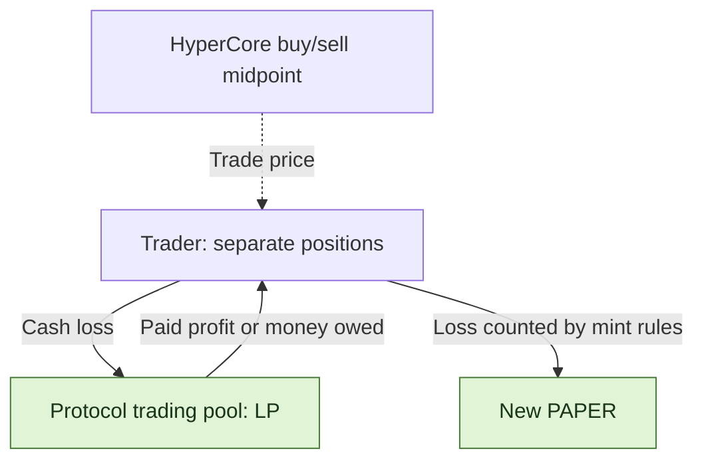
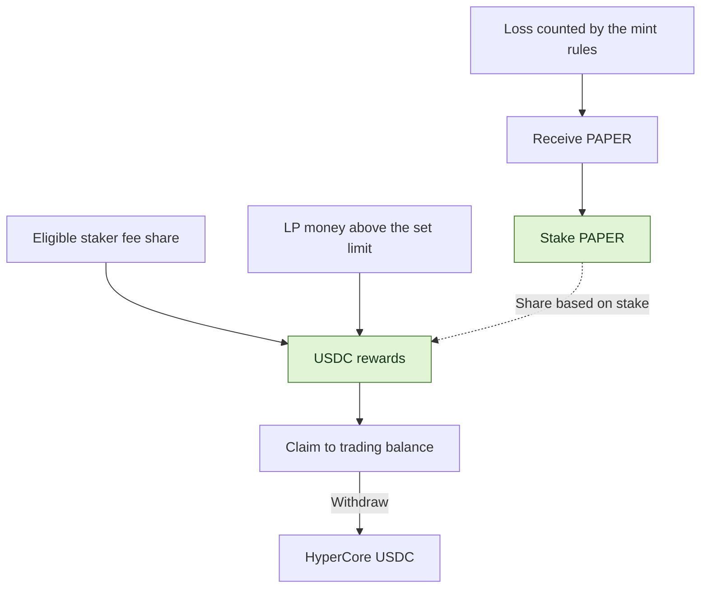

<h1 align="center">papertrade-research</h1>

<p align="center">
  <strong>A plain guide to Papertrade trading, fees and PAPER rewards.</strong>
</p>


<p align="center">
  <a href="docs/mechanism-map.md"></a>
  <a href="STATUS.md"></a>
  <a href="LICENSE"></a>
</p>

<p align="center">
  <a href="README.zh-CN.md">中文</a> ｜ <strong>English</strong>
</p>

<p align="center">
  <a href="#features">Features</a> ·
  <a href="#paper-mint-curve">Mint curve</a> ·
  <a href="#trading-costs">Fees</a> ·
  <a href="#paper-the-dividend-token">PAPER</a> ·
  <a href="#independent-clients-and-api-access">API access</a> ·
  <a href="#explore-the-research">Explore the research</a> ·
  <a href="docs/sources.md">Sources</a>
</p>

[Papertrade](https://docs.papertrade.xyz/) lets you trade perpetual futures on HyperEVM. The protocol's trading pool (LP) takes the other side of each trade. Losses can earn PAPER, and staking PAPER lets you share in USDC rewards.

🔎 We use official docs, public code and [REA](https://github.com/morluto/rea) to explain how it works and check what the evidence supports. [Progress](STATUS.md) · [Sources](docs/sources.md)

**Versions:** this page explains documented **Contract set 2**, which the official history dates from **2026-10-21**; set 1 ran October 7–21. The [October 28 review](docs/current-product-review.md) connects product, contracts, services and funding. [Confirmed updates and evidence](docs/research-notes/016-2026-10-28-sync.md) · [Official changes](https://docs.papertrade.xyz/dev/protocol-changes/)

## Features

| Feature | How it works |
|---|---|
| 🤝 **Trade against the pool** | You trade against Papertrade's LP. Your gains come from the pool; cash losses add to it. |
| 📊 **Hyperliquid prices** | Trade prices use the midpoint between HyperCore's best buy and sell prices. Balances are recorded on HyperEVM. |
| ⚡ **Up to 1000× leverage** | Each position has its own margin. You choose margin and leverage when opening; they stay fixed. Each position closes in full, and long and short positions stay separate. |
| 💸 **0 opening fee · 0 funding payments** | Winning trades have profit deductions and a fee. The order service pays gas for trades it sends. |
| ⏳ **Orders can wait** | The order service, called the relayer, groups requests and sends them on chain. Both opening and closing can take time. |
| 🪙 **Losses can earn PAPER** | The mint rules decide how much of a loss earns PAPER. Stake those tokens to share in USDC rewards. |

> 🖥️ <strong>Position-management scope:</strong> the client captured on October 22 used market orders and whole-position closes; native limit/TP/SL and partial-close interfaces were not established in that inspection. [Captured client scope](docs/research-notes/012-independent-clients-orders-and-bridges.md#position-management-and-order-types).
> At high leverage, a small move against you can wipe out a position. A close request can still be waiting when liquidation happens.

🧩 <strong>Why look at PAPER?</strong> A losing close or liquidation can create PAPER, which can then be staked for rewards. To understand that trade-off, look at the trading loss, the new tokens and the money available for rewards together.

[How trading works](docs/mechanism-map.md)

## PAPER mint curve

**Before, the old curve gave fewer PAPER per $1 as it progressed. Now, new tokens are based on the total PAPER already issued.** As that total grows, the same loss can earn more tokens, while existing holders own a smaller share.


| Question | Before | Now |
|---|---|---|
| **How much PAPER does a loss earn?** | 100 PAPER/$ applied in the old low-LP branch. The later curve could already be at 25 → 20 → about 10. Crossing the LP threshold again could cause a sharp drop; 25/20 are examples, not fixed levels. | Roughly $1M of losses counted by the mint rules adds 0.1% of the PAPER already issued. A bigger total means more new tokens for the same loss. The exact rate depends on the settings. |
| **How does the total grow?** | In the falling part of the old curve, equal losses added fewer new tokens over time. | Losses keep adding tokens based on the total at that point. There is no fixed daily release, and the docs state **no supply cap**. If you keep the same number of tokens, your share of the total falls. |
| **What if the LP owes more than it has?** | The old low-LP rate applied. | The longer the shortfall lasts, the bigger the bonus: 1× to 5× over 3 days. It only boosts the part of a loss that qualifies and helps fill the shortfall. |

💡 **A simple example:** start with 10B PAPER. If each $1M loss step adds 0.1% of the previous total, it grows **10B → 10.01B → 10.02001B**. This shows the idea; the contract uses a more detailed calculation. Creating PAPER does not add the same value in USDC.

📍 **What we found on 2026-10-22:** about **8.903B PAPER** had been issued. The base rate for a small loss was about **9.802 PAPER per $1** before any shortfall bonus. These are values from that check, not live numbers. USDC rewards also depend on how much money is available, who has staked and when it is shared out.

🗓️ **When it changed:** the official set-2 transaction is in block **49169385**, timestamped **2026-10-21 22:00:02 UTC / October 22 06:00:02 Asia/Shanghai**. This dates the transaction block; individual initializer and parameter effects require their own evidence. [Receipt and block anchor](docs/research-notes/016-2026-10-28-sync.md#upgrade-transaction-anchor).

[Old mint rules](https://docs.papertrade.xyz/v1/how/mint-curve/#shape) · [New mint rules](https://docs.papertrade.xyz/how/mint-curve/#shape) · [Examples and formulas](docs/readme-figures.md#issuance-old-vs-new) · [Versions and evidence](docs/research-notes/015-contract-set-2.md#6-issuance-old-docs-and-remaining-work)

## Trading costs

| When | What you pay |
|---|---|
| **Open a position** | 0 opening fee |
| **Keep it open** | 0 funding payments |
| **The relayer sends your trade** | The relayer pays gas |
| **Close with a profit** | Gain is reduced first; the normal fee-applicable branch charges **2% of scaled profit**, with an extra **0.5%** for an approved session builder |
| **Close with a loss** | Your loss, with no extra trading fee added |

💡 The documented order is **0.2 bps deadband → small-move holdback → asymmetric impact → win fee**. The complete holdback bands are **0.75–6 bps** for the standard curve and **0.3–10 bps** for off-hours. Holdback is zero at the endpoints and outside each band. These are price-move ranges, not fee rates.

The docs say the payout still grows as the price moves further in your favor. A dedicated keeper account selects the standard or off-hours mode. Both formulas are built into the contract.

Those numbers describe price moves, not fee rates. Larger moves still face the existing profit adjustment, called asymmetric impact, and the final 2% fee.

[Fee examples and formulas](docs/readme-figures.md#profit-retention-examples) · [How the new cut works](docs/research-notes/014-official-announcement-crosscheck.md#3-the-new-profit-adjustment-is-a-price-move-band)

**Builder fees:** on the ordinary winning branch, 2% plus 0.5% leaves **97.5% of scaled profit**; without a builder it is 98%. On losses, the builder portion comes from LP gain and is excluded from PAPER basis, without adding to the trader’s loss. Builder accrual needs an empty payout queue and sufficient funding; an uncredited winning builder deduction stays with the LP. Liquidations pay none; the canonical frontend names no builder. [Official rules and scope](docs/current-product-review.md#settlement-and-the-meaning-of-trading-cost).

**The rules can change.** Rule changes and upgrades use the protocol's governance permissions. The timelock we checked had a 1-day minimum delay. A guardian can pause new positions without that wait; the owner must approve reopening them. [Who can change the rules](docs/research-notes/011-loss-governance-staking-and-payments.md#2-who-can-change-rules-and-what-actually-changed) · [Upgrade history](docs/research-notes/013-market-state-funding-and-upgrade-followup.md#1-the-scheduled-implementations-are-now-installed)

## Who pays whom?



| Two different waits | What is waiting? |
|---|---|
| **Order queue** | Your open or close request waits for the relayer to send it and for it to succeed. |
| **Payout queue** | Profit that has already been recorded waits for enough money to pay it. The docs say the oldest claims are paid first. |

For a position opened with cash, returned margin is recorded separately from profit still owed. Some positions use a claim on unpaid money instead of cash; a loss then reduces that claim and adds no new cash to the pool.

New PAPER and the LP balance shown by the protocol do not tell you how much cash is ready to pay winners. A payout queue orders payments; it does not create money or promise a fixed wait. We still need real examples of partly paid claims to check the full process.

[Order and payout queues](docs/research-notes/007-queue-and-dividend-payment.md) · [What affects payment](docs/research-notes/011-loss-governance-staking-and-payments.md#5-payment-capacity-when-many-traders-win)

## PAPER: the dividend token

🪙 Losses can create PAPER. USDC rewards come from trading fees and money the LP can share above its set limit.

**You cannot freely send PAPER from one wallet to another.** Transfers use the allowed staking contract path. The team says an outside market for shorting PAPER could make attacks on the LP more profitable. That is a risk argument; it does not prove that outside derivatives or attacks are impossible. [Transfer rules and the team's reasoning](docs/research-notes/014-official-announcement-crosscheck.md#1-transfer-restrictions-and-the-external-short-argument)



| Step | How it works |
|---|---|
| 🪙 **Get PAPER** | The amount depends on the loss counted by the rules, the total supply and any LP-shortfall bonus. |
| 📥 **Stake** | You share rewards based on your stake when they are divided up. Holding PAPER without staking earns no share. The docs list no lockup or cooldown. |
| 💵 **Fund rewards** | The documented 1% share of applicable settled gains/losses, when queue and LP-funding conditions permit, plus distributable overflow above the $5M cap. Debt-funded liquidation is an exception. |
| ↗️ **Claim** | Rewards enter your trading balance. Withdrawing to HyperCore is a separate step. |

**Who can move the fees into staking?** Only PaperStaking may request the Exchange fee push. The docs specify **keeper-signed `distributeBySig` through the relayer**; direct public distribution is disabled. Distribution updates reward shares; `pendingReward` includes already distributed amounts. Claim credits Exchange balance, then withdrawal is separate. [Documented flow](https://docs.papertrade.xyz/paper/staking/) · [Service architecture](docs/current-product-review.md#service-architecture-and-control).

**When rewards are shared matters.** The code we checked gives no extra weight for staking longer. Adding or removing a stake does not first share out the waiting fees. For example, if 100 reward units are waiting and a second equal stake joins before they are shared, each gets 50. If they are shared first, the first stake gets 100. Rewards already assigned stay with that holder after unstaking. This is a code-based example, not a tested way to make money. [Reward timing](docs/research-notes/011-loss-governance-staking-and-payments.md#3-long-term-staking-versus-joining-immediately-before-allocation)

We checked 8 reward distributions in two periods; their amounts matched fee funding. None showed an extra LP-surplus payment, but that does not rule it out at other times. A plan to raise the LP reward limit to $10M was cancelled. Sharing rewards, claiming them and receiving money outside the platform are separate steps. [Where rewards came from](docs/research-notes/011-loss-governance-staking-and-payments.md#4-where-distributions-actually-came-from) · [Cancelled limit change](docs/research-notes/011-loss-governance-staking-and-payments.md#2-who-can-change-rules-and-what-actually-changed)

[More on PAPER and staking](docs/research-notes/006-current-mechanisms.md) · [How rewards are paid](docs/research-notes/007-queue-and-dividend-payment.md)

## Liquidation: trigger price and margin loss

⚠️ Liquidation happens before the price that would use up all your margin. The documented safety buffer is about 5bps (0.05%) around that price. Liquidation takes the position's full margin.


> 🧮 <strong>Example: 100× long.</strong> Entry price 100 → zero-margin price 99 → liquidation price about 99.0495, or 99.05.
> Closing before that point can return the margin left in the position. Liquidation takes it all.

**A close request can still end as liquidation.** In set 2, a close executed at or beyond the contract's bust price settles as hard liquidation and takes the full margin. This matters while a close waits in the queue. [Rule and boundary checks](docs/research-notes/015-contract-set-2.md#5-hard-liquidation-at-the-boundary)

The higher the leverage, the bigger the buffer is relative to your margin. [Formula and rounding](docs/research-notes/006-current-mechanisms.md#liquidation-exact-buffer-basis-and-inclusive-threshold).

## Independent clients and API access

🛠️ A custom client follows this path: **read prices, rules and account data → sign a request → send it to the official relayer → follow the trade and balance changes**. Opens and closes still go through the allowed BatchExecutor contract.

| Interface | What you use it for |
|---|---|
| HTTP: `/query/protocol/…` | Protocol totals, queues and PAPER activity. |
| Public WebSocket: `trading:current` | Whether trading is open and what limits apply, such as leverage and position size. |
| Account queries and live updates: `/query/accounts/…`, `/state/user/live?wallet=…` | Your balance, positions and past actions. The exact login and access rules still need checking. |
| Signed requests: `POST /intents` | Session setup, open/close requests, withdrawal to HyperCore and PAPER actions. Match the reply to your request, then check execution. A request being accepted does not mean the trade happened. |

In the [previously captured client](docs/research-notes/012-independent-clients-orders-and-bridges.md#position-management-and-order-types), selected positions close in full and additional opens create separate positions. Its inspected interfaces did not establish single-position partial close, native limit/TP/SL, or updates to existing margin/leverage.

**Deposits and withdrawals:**

| Deposit source | Route |
|---|---|
| USDC on Ethereum, Arbitrum or Solana | Circle CCTP/forwarding reaches HyperEVM, then CoreDepositWallet credits the personal HyperCore address; Papertrade sweep/finalize credits trading balance. |
| USDG on Robinhood | Across brings USDC to HyperEVM. The destination contracts then send it through CoreDepositWallet to your deposit address. |
| USDC on HyperEVM or HyperCore | Use the guided CoreDepositWallet/Core route. A raw ERC-20 transfer to the matching HyperEVM address is not a normal deposit credit. |

Withdrawals first move trading funds to your HyperCore spot account. Sending them onward to HyperEVM, Ethereum, Arbitrum or Solana needs extra transfer approval. The withdrawal routes we found do not include Robinhood. A bridge transfer, a platform credit and arrival at the final address are different steps.

**Funding implementation:** route construction above comes from the dated client study and current official descriptions. Circle’s [HyperCore guide](https://developers.circle.com/cctp/concepts/cctp-on-hypercore) corroborates the two-step design; Across’s [API reference](https://docs.across.to/api-reference) documents Bearer/`integratorId` and distinguishes current APIs from legacy routes. Vendor support is not a live app quote. [Routes, minimums and exceptional reconciliation](docs/current-product-review.md#funding-routes-providers-and-arrival).

**Builder codes:** registration names an approved builder in `feeAddress`. Approval/rate changes use the 24-hour timelock, with a 1% rate cap; the multisig can remove a builder immediately. Previous earnings remain claimable. Claims credit Exchange balance, with an uncovered part queued. [Builder and payment rules](https://docs.papertrade.xyz/how/builder-codes/).

[Client and signing guide](docs/independent-client-guide.md) · [Orders and funding routes](docs/research-notes/012-independent-clients-orders-and-bridges.md)

## Explore the research

| Start here | What you will find |
|---|---|
| [Product, contracts, services and business model](docs/current-product-review.md) | Bilingual integrated review and funding/provider maps |
| [Confirmed October 28 updates](docs/research-notes/016-2026-10-28-sync.md) | Changes, source scope and the upgrade transaction block |
| [How the parts fit together](docs/mechanism-map.md) | A map of 14 topics covered by this project |
| [Notes](docs/research-notes/) · [Case records](research/cases/) | Explanations, sources and the results of checks |
| [Losses, rule changes and reward timing](docs/research-notes/011-loss-governance-staking-and-payments.md) | Five common questions, examples and what is still unknown |
| [REA analysis](docs/research-notes/010-rea-frontend-and-contract-crosscheck.md) | How the client sends requests, shows PAPER ratios and calls contracts |
| [Calculation helpers](packages/research/mechanics.ts) | Functions for the old mint curve, liquidation price and pending rewards |
| [Evidence tools](docs/chain-evidence.md) | Checks that records and versions fit together |
| [Read-only collection](docs/readonly-collection.md) · [Safe export](docs/safe-export.md) | How public data is collected and reviewed before sharing |
| [Method](docs/research-method.md) · [Progress](STATUS.md) · [Roadmap](ROADMAP.md) | How we work and what comes next |

<details>
<summary><strong>Run the local checks</strong> · Node.js ≥ 24.12.0 / pnpm 11.25.0</summary>

```sh
pnpm install --frozen-lockfile
pnpm test
pnpm typecheck
pnpm validate:records
```

Tests and validation run locally. Live collection is an explicit, separate command.

</details>

---

[Contribute](CONTRIBUTING.md) · [Data policy](DATA_POLICY.md) · [Apache-2.0](LICENSE) · [Third-party notices](THIRD_PARTY_NOTICES.md)
