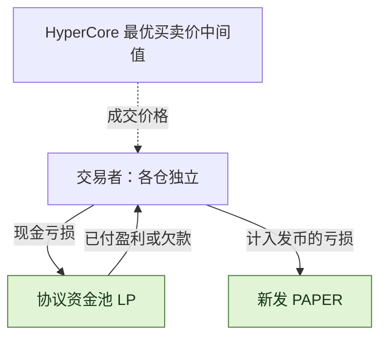
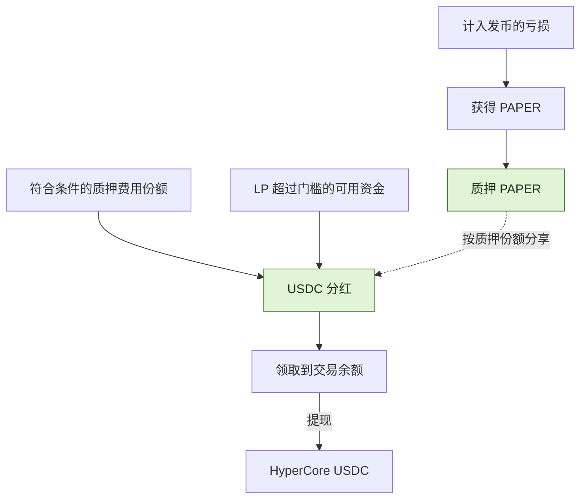

<h1 align="center">papertrade-research</h1>

<p align="center">
  <strong>看懂 Papertrade：交易、费用和 PAPER 分红。</strong>
</p>


<p align="center">
  <a href="docs/mechanism-map.md"></a>
  <a href="STATUS.md"></a>
  <a href="LICENSE"></a>
</p>

<p align="center">
  <strong>中文</strong> ｜ <a href="README.md">English</a>
</p>

<p align="center">
  <a href="#特性介绍">特性介绍</a> ·
  <a href="#paper-铸币曲线">铸币曲线</a> ·
  <a href="#交易成本">交易费用</a> ·
  <a href="#paper分红代币怎样运作">PAPER 分红</a> ·
  <a href="#独立客户端与-api-接入">API 接入</a> ·
  <a href="#探索研究仓库">仓库导航</a> ·
  <a href="docs/sources.md">来源</a>
</p>

[Papertrade](https://docs.papertrade.xyz/) 是 HyperEVM 上的永续合约平台。你和协议的资金池（LP）交易，亏损可获得 PAPER，质押 PAPER 后可参与 USDC 分红。

🔎 我们结合官网文档、公开代码和 [REA](https://github.com/morluto/rea)，解释它怎样运作，也核对哪些说法有证据支持。[进度](STATUS.md) · [来源](docs/sources.md)

**版本说明：** 本页介绍官网描述的 **Contract set 2**，官方记录为 **2026-10-21** 起；set 1 为 10 月 7–21 日。[10 月 28 日综合报告](docs/current-product-review.zh-CN.md)串联产品、合约、服务与资金路线。[确认更新与证据](docs/research-notes/016-2026-10-28-sync.md) · [官方变更表](https://docs.papertrade.xyz/dev/protocol-changes/)

## 特性介绍

**竞品研究：** [YOLO、Cardboard、Trade Everything、Rektrade与STOX](docs/competitors/README.zh-CN.md)，含双语档案、带时点的业务观测和[手动刷新命令](docs/competitors/refresh.zh-CN.md)。

| 特性 | 怎么运作 |
|---|---|
| 🤝 **和资金池交易** | 盈利由 Papertrade 的 LP 支付，现金亏损则进入池子。 |
| 📊 **使用 Hyperliquid 价格** | 交易价格取 HyperCore 最优买价和卖价的中间值，余额在 HyperEVM 记账。 |
| ⚡ **最高 1000× 杠杆** | 每个仓位单独放保证金，保证金和杠杆开仓后固定。每仓整仓平仓，多仓和空仓互不合并。 |
| 💸 **0 开仓费 · 0 资金费** | 盈利平仓会先调整盈利，再收手续费；由订单服务发送的交易，gas 由服务支付。 |
| ⏳ **下单可能排队** | 订单服务叫 relayer，会把请求分批上链。开仓和平仓都可能等待。 |
| 🪙 **亏损可获得 PAPER** | 发币规则决定亏损中有多少能换算成 PAPER，拿到后可质押参与 USDC 分红。 |

> 🖥️ <strong>仓位管理的版本范围：</strong>10 月 22 日采集的客户端使用市价单、整仓关闭；当时检查的接口未建立原生限价、止盈止损或部分平仓能力。[当时的客户端范围](docs/research-notes/012-independent-clients-orders-and-bridges.md#position-management-and-order-types)。
> 高杠杆下，价格稍微走反就可能爆仓。平仓请求还在排队时，仓位也可能先被清算。

🧩 <strong>为什么关注 PAPER？</strong> 亏损平仓或清算后可能拿到 PAPER，再拿去质押分红。判断这件事值不值，要把交易亏损、拿到的币和真正可分的钱放在一起看。

[交易怎样运作](docs/mechanism-map.md)

**为什么体感快：** 10 月 22 日客户端通过独立推送通道接收报价、K 线和账户更新，会话密钥省去逐笔开平仓的钱包弹窗；个人充值地址、转发和自动归集则减少入金步骤。行情更新、请求受理和最终结算各自完成。[体验与技术细节](docs/current-product-review.zh-CN.md#为什么体感快)。

## PAPER 铸币曲线

**以前，旧曲线越往后，每亏 $1 发的币越少。现在，发多少币取决于当时已经发行了多少 PAPER。** 总量越大，同样亏损拿到的币越多；原来持币不动的人，占比也会变小。


| 想知道什么 | 以前 | 现在 |
|---|---|---|
| **亏损能拿多少 PAPER？** | 100 PAPER/$ 是旧规则中 LP 较低时的分支，后段早已可能降到 25 → 20 → 约 10。再次跨过 LP 门槛时可能突然下降；25/20 是例子，不是固定档位。 | 每 $1M 计入发币的亏损，大约增发当时 PAPER 总量的 0.1%。总量越大，同样亏损拿到的币越多，精确比例还要看参数。 |
| **总量怎么增加？** | 在旧曲线下降的部分，同样亏损带来的新增币数越来越少。 | 亏损持续推动发币，每次按当时总量计算；没有固定的每日释放量，官网也明确写了**没有发行上限**。持币数不变，占总量的比例会下降。 |
| **LP 不够还欠款时呢？** | 回到旧规则中低 LP 的发币分支。 | 缺口持续越久，奖励越高：3 天内从 1 倍升到 5 倍，只给符合条件、用于填补缺口的那部分亏损加成。 |

💡 **看个简单例子：** 从 10B PAPER 开始，假设每次 $1M 亏损都按上一次总量增发 0.1%，总量就是 **10B → 10.01B → 10.02001B**。这是帮助理解的算例，合约的实际算法更细。多发 PAPER 不会凭空增加同等价值的 USDC。这里 B = 10亿，M = 100万。

📍 **2026-10-22 查到的数值：** 总量约 **8.903B PAPER**，小额亏损的起始发币率约 **9.802 PAPER/$**，还没算 LP 缺口加成。这些是那次查询的数值，不是实时数据。能分到多少 USDC，还要看有多少钱可分、谁在质押，以及什么时候分。

🗓️ **什么时候变的：** 官网指定的 set 2 交易位于区块 **49169385**，区块时间为 **2026-10-22 06:00:02（北京时间）／10 月 21 日 22:00:02 UTC**。这是交易所在区块的时间，具体初始化和参数效果须分别核对。[回执与区块证据](docs/research-notes/016-2026-10-28-sync.md#upgrade-transaction-anchor)。

[旧版发币说明](https://docs.papertrade.xyz/v1/how/mint-curve/#shape) · [新版发币说明](https://docs.papertrade.xyz/how/mint-curve/#shape) · [算例与公式](docs/readme-figures.md#issuance-old-vs-new) · [版本与证据](docs/research-notes/015-contract-set-2.md#6-issuance-old-docs-and-remaining-work)

## 交易成本

| 什么时候 | 你付什么 |
|---|---|
| **开仓** | 0 开仓费 |
| **持仓** | 0 资金费 |
| **Relayer 发送交易** | Gas 由 relayer 支付 |
| **盈利平仓** | 先调整盈利；正常费用适用分支收取**缩减后盈利的 2%**，获批会话 Builder 另收 **0.5%** |
| **亏损平仓** | 承担亏损，不额外再加一笔交易费 |

💡 官网计算顺序是 **0.2 bps deadband → 小幅盈利 holdback → asymmetric impact → win fee**。holdback 完整区间为标准模式 **0.75–6 bps**、非正常时段模式 **0.3–10 bps**，两端及区间外为零。这些是价格变动范围，不是手续费率。

官网说明，即使小幅盈利被扣减，价格继续朝有利方向走时，付款仍会增加。一个专门的 keeper 账户负责切换正常／非正常时段模式，两套算法都写在合约里；不是页面自己随意改算法。

这些数字说的是价格变动，不是手续费率。更大的价格变动仍要经过原来的盈利调整（asymmetric impact）和最后的 2% 手续费。

[费用算例与公式](docs/readme-figures.md#profit-retention-examples) · [新扣减怎样计算](docs/research-notes/014-official-announcement-crosscheck.md#3-the-new-profit-adjustment-is-a-price-move-band)

**Builder 费用：** 普通盈利分支中，2% 加 0.5% 后留下**缩减后盈利的 97.5%**，不带 Builder 为 98%。亏损时从 LP 收益划出 Builder 部分，并排除在 PAPER 基数外，不额外增加交易者亏损。Builder 记账要求付款队列为空且资金足够；盈利时未能记给 Builder 的额外扣减留在 LP。清算不收 Builder 费，官方前端不登记 Builder。[费用规则与范围](docs/current-product-review.zh-CN.md#合约结算与真实交易成本)。

**规则可以修改。** 改规则和升级需要相应的治理权限。我们查到的时间锁最少等 1 天；guardian 可以不等时间锁就暂停新开仓，恢复开仓需要 owner 批准。[谁能改规则](docs/research-notes/011-loss-governance-staking-and-payments.md#2-who-can-change-rules-and-what-actually-changed) · [升级记录](docs/research-notes/013-market-state-funding-and-upgrade-followup.md#1-the-scheduled-implementations-are-now-installed)

## 盈亏由谁承担？



| 三种不同的等待 | 在等什么？ |
|---|---|
| **下单排队** | 开仓或平仓请求，等待 relayer 发送并成功执行。 |
| **付款排队** | 盈利已经记账，但还在等足够的钱支付。官网说先付较早的欠款。 |
| **提现处理** | 可用余额要完成提现执行和 HyperCore 入账；继续跨链还要确认目的链到账。 |

现金开仓时，返还保证金和还没支付的盈利分开记账。有些仓位用的是尚未收到的款项，而不是现金；这种仓位亏损时，相应欠款会减少，不会有新现金进入池子。

新发了多少 PAPER、页面记录的 LP 余额是多少，都不能直接说明现在有多少现金能付给赢家。付款队列只是安排顺序，不会产生钱，也不保证固定等待时间。完整流程还缺真实的部分付款案例来核对。

[下单和付款排队](docs/research-notes/007-queue-and-dividend-payment.md) · [哪些因素影响付款](docs/research-notes/011-loss-governance-staking-and-payments.md#5-payment-capacity-when-many-traders-win)

**非清算教学例：** 假设起初兑付队列为空，现金保证金 100、净盈利 30，LP 只能付其中 10，平仓执行后是 **110 可用＋20 排队**。已有债权优先，不能拿这个例子越过前面的队列先收钱。[现金／债权算例与提现阶段](docs/current-product-review.zh-CN.md#到底在排什么队)。

## PAPER：分红代币怎样运作？

🪙 亏损可以产生 PAPER。USDC 分红的钱，来自交易费和 LP 超过设定门槛后能拿出来分享的部分。

**PAPER 不能在钱包间自由转账。** 转账要走允许的质押合约路径。团队认为，如果外部市场能做空 PAPER，攻击 LP 可能变得更有利可图。这是在解释风险，不能证明外部衍生品或攻击绝不可能。[转账规则与团队的理由](docs/research-notes/014-official-announcement-crosscheck.md#1-transfer-restrictions-and-the-external-short-argument)



| 环节 | 怎么运作 |
|---|---|
| 🪙 **拿 PAPER** | 取决于计入发币的亏损、当时总量，以及是否有 LP 缺口加成。 |
| 📥 **质押** | 按分红那一刻的质押份额分享。只持币、不质押，没有这份分红。官网没有写锁定期或冷却期。 |
| 💵 **准备分红资金** | 官网描述为队列及 LP 支付条件允许时，适用结算盈亏中的 1% 份额，加上 LP 超过 $5M 门槛后的可分配盈余；债权保证金清算有例外。 |
| ↗️ **领取** | 先进入交易余额，提现到 HyperCore 是下一步。 |

**谁能把费用送入分红？** 仅 PaperStaking 可请求 Exchange 推送费用。官网明确分配使用 **keeper 签名、经 relayer 提交的 `distributeBySig`**，直接公开分配已禁用。分配更新奖励份额，`pendingReward` 只含已分配部分；领取进入交易余额，提现另行完成。[官方流程](https://docs.papertrade.xyz/paper/staking/) · [服务架构](docs/current-product-review.zh-CN.md#服务架构与权限)。

**什么时候分钱，会影响谁拿到多少。** 我们检查的代码不因为质押更久就多给权重，加入或退出质押也不会先把积累的费用分掉。例如有 100 单位奖励待分，后来者先加入相同份额，两人各得 50；如果先分再加入，原质押者拿 100。已经分给你的奖励，退出质押后也保留。这是按代码举例，还没验证成真实赚钱策略。[分红时机](docs/research-notes/011-loss-governance-staking-and-payments.md#3-long-term-staking-versus-joining-immediately-before-allocation)

我们在两个时期核对了 8 笔分红，金额都能和手续费来源对上，没有一笔证明额外用了 LP 盈余，但不能排除其他时期有。把 LP 分红门槛改为 $10M 的方案已经取消。分红记到名下、领取入账、真正转到平台外，是不同的步骤。[分红的钱从哪来](docs/research-notes/011-loss-governance-staking-and-payments.md#4-where-distributions-actually-came-from) · [取消的门槛变更](docs/research-notes/011-loss-governance-staking-and-payments.md#2-who-can-change-rules-and-what-actually-changed)

[更多 PAPER 与质押说明](docs/research-notes/006-current-mechanisms.md) · [分红怎样支付](docs/research-notes/007-queue-and-dividend-payment.md)

## 清算：触发价格与保证金损失

⚠️ 清算会发生在理论上用完保证金的价格之前。官网写的缓冲约为 5bps（0.05%），围绕这个理论价格计算；一旦清算，损失该仓位全部保证金。


> 🧮 <strong>100× 多仓例子：</strong> 开仓价 100 → 理论上保证金归零的价格 99 → 清算价约 99.0495，也就是 99.05。
> 触发前平仓，可以拿回仓里剩余的钱；清算会损失全部保证金。

**发了平仓请求，也可能按清算处理。** 在 set 2，如果平仓执行时价格已经达到或越过合约的清算触发价（bust，已含缓冲），这次平仓会按强制清算结算，损失全部保证金。排队时仍要留意这一点。[新版规则与边界检查](docs/research-notes/015-contract-set-2.md#5-hard-liquidation-at-the-boundary)

杠杆越高，缓冲相当于保证金的比例越大。[公式与取整](docs/research-notes/006-current-mechanisms.md#liquidation-exact-buffer-basis-and-inclusive-threshold)。

## 独立客户端与 API 接入

🛠️ 自写客户端的流程是 **读取价格、规则和账户数据 → 签署请求 → 发给官方 relayer → 跟踪交易和余额变化**。开平仓仍要经过获准的 BatchExecutor 合约。

| 接口 | 用来做什么 |
|---|---|
| HTTP：`/query/protocol/…` | 查看协议总量、队列和 PAPER 动态。 |
| 公共 WebSocket：`trading:current` | 查看能否交易、杠杆和仓位大小限制。 |
| 账户查询和实时更新：`/query/accounts/…`、`/state/user/live?wallet=…` | 查看自己的余额、仓位和历史操作；具体登录及访问规则还要核对。 |
| 签名请求：`POST /intents` | 设置会话授权、开平仓、提现到 HyperCore，以及 PAPER 操作。先把回复和请求对上，再查执行结果；被接收不等于已经成交。 |

在[此前采集的客户端](docs/research-notes/012-independent-clients-orders-and-bridges.md#position-management-and-order-types)中，可选择若干仓位全平，再开仓形成独立仓位；当时检查未建立单仓部分平仓、原生限价／止盈止损或修改已有保证金／杠杆的接口。

**充值和提现：**

| 充值来源 | 怎么走 |
|---|---|
| Ethereum、Arbitrum、Solana 上的 USDC | Circle CCTP／转发先到 HyperEVM，再经 CoreDepositWallet 到个人 HyperCore 地址，最后归集确认后记入交易余额。 |
| Robinhood 上的 USDG | Across 把 USDC 带到 HyperEVM，目标链合约再通过 CoreDepositWallet 送到充值地址。 |
| HyperEVM、HyperCore 上的 USDC | 按 App 引导走 CoreDepositWallet／Core 路线；原始 ERC-20 转账到同地址的 HyperEVM 一侧，不会作为普通充值入账。 |

提现先把交易资金转到 HyperCore 现货账户。继续转到 HyperEVM、Ethereum、Arbitrum 或 Solana，需要额外的转账授权。已找到的提现路线不包含 Robinhood。跨链完成、平台入账、最后一个地址收到钱，需要分开跟踪。

**资金实现范围：** 上表来自注明日期的客户端研究及当前官方描述。Circle [HyperCore 文档](https://developers.circle.com/cctp/concepts/cctp-on-hypercore)佐证两步路径；Across [API 文档](https://docs.across.to/api-reference)要求 Bearer／`integratorId`，并区分当前 API 与 legacy 路线。供应商支持不等于 App 的实时报价。[资金路线、最低金额与异常补记](docs/current-product-review.zh-CN.md#充值提现桥和服务商)。

**Builder codes：** 会话注册在 `feeAddress` 指定获批 Builder；批准和费率修改经 24 小时时间锁，费率上限 1%，多签可立即移除。之前已赚费用仍可领取；领取先进入交易余额，无法覆盖部分进入兑付队列。[Builder 与付款规则](https://docs.papertrade.xyz/how/builder-codes/)。

[客户端与签名指南](docs/independent-client-guide.md) · [订单和资金路线](docs/research-notes/012-independent-clients-orders-and-bridges.md)

## 探索研究仓库

| 从这里开始 | 可以看到什么 |
|---|---|
| [中文文字汇总](docs/papertrade-summary.zh-CN.md) | 可直接整理成文档的现行机制与业务说明 |
| [产品、合约、服务与业务模式](docs/current-product-review.zh-CN.md) | 综合报告、资金路线和服务商关系 |
| [10 月 28 日确认更新](docs/research-notes/016-2026-10-28-sync.md) | 新旧差异、来源范围和升级交易区块 |
| [各部分怎样连接](docs/mechanism-map.md) | 本项目关注的 14 个话题 |
| [笔记](docs/research-notes/) · [案例记录](research/cases/) | 机制解释、来源和检查结果 |
| [亏损、改规则与分红时机](docs/research-notes/011-loss-governance-staking-and-payments.md) | 五个常见问题、例子和还不清楚的地方 |
| [REA 分析](docs/research-notes/010-rea-frontend-and-contract-crosscheck.md) | 客户端怎样发送请求、显示 PAPER 比例和调用合约 |
| [计算函数](packages/research/mechanics.ts) | 旧铸币曲线、清算价格和待领取奖励的算法 |
| [证据工具](docs/chain-evidence.md) | 检查记录与版本是否对得上 |
| [只读采集](docs/readonly-collection.md) · [安全导出](docs/safe-export.md) | 怎样读取公开数据，以及分享前做哪些检查 |
| [方法](docs/research-method.md) · [进度](STATUS.md) · [后续计划](ROADMAP.md) | 我们怎样做、接下来做什么 |

<details>
<summary><strong>运行本地检查</strong> · Node.js ≥ 24.12.0 / pnpm 11.25.0</summary>

```sh
pnpm install --frozen-lockfile
pnpm test
pnpm typecheck
pnpm validate:records
```

测试与验证在本地运行；在线采集使用单独的显式命令。

</details>

---

[参与贡献](CONTRIBUTING.md) · [数据政策](DATA_POLICY.md) · [Apache-2.0](LICENSE) · [第三方声明](THIRD_PARTY_NOTICES.md)
