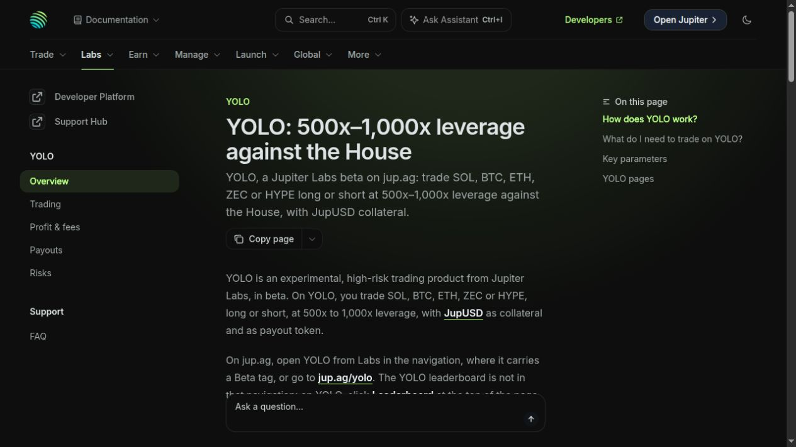
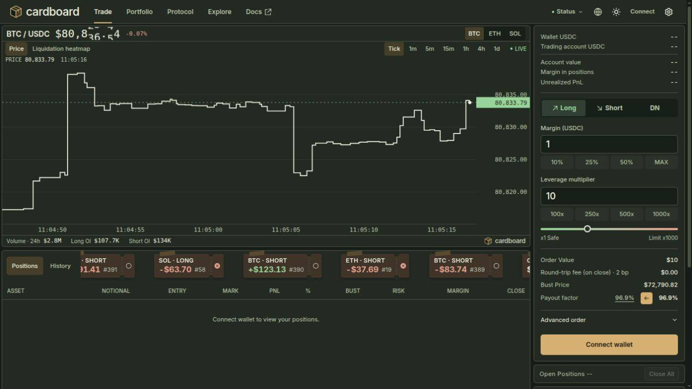
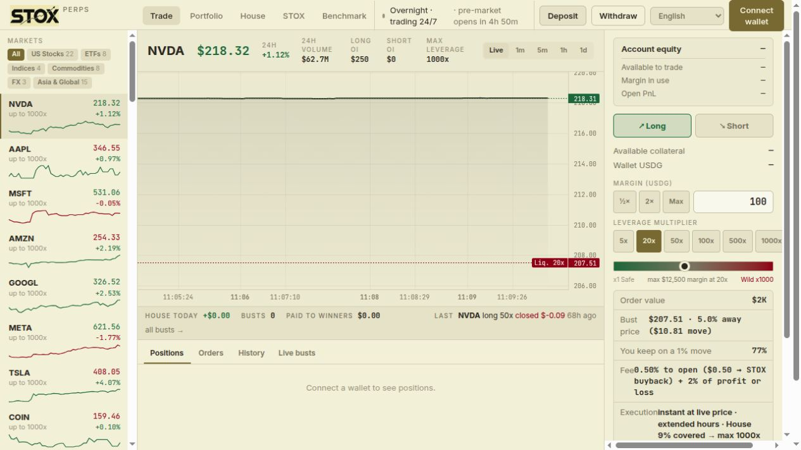
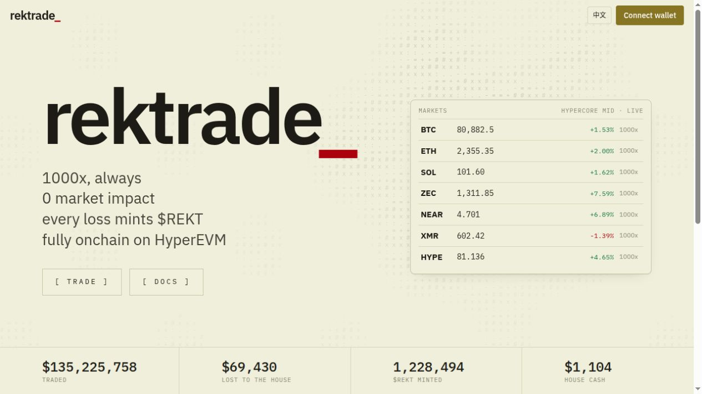
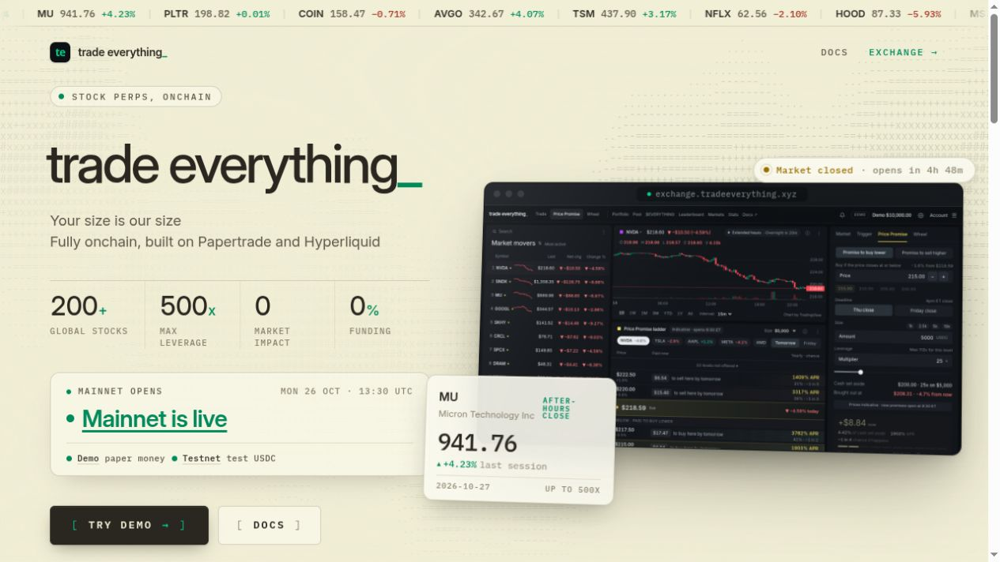
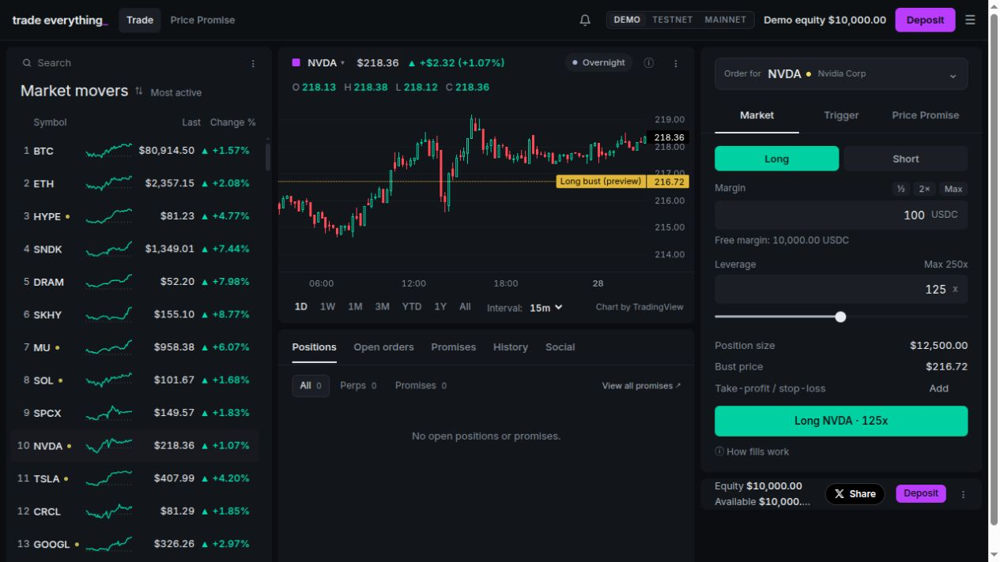
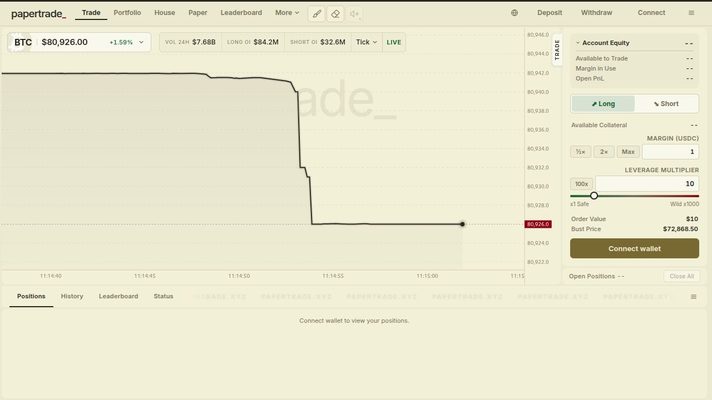

# Browser checks and screenshots

[中文](browser-checks.zh-CN.md) · [Basic facts](basics.md) · [Comparison](README.md)

Seven actual browser viewport screenshots were retained on28October2026. Times below are save times; precise frame and business-as-of times are unavailable. No wallet, login or orders; only an optional referral prompt was dismissed. Page claims are not contract execution, paid-profit proof or complete business statistics. [Sources and hashes](../../research/competitors/sources/browser.json); [observations](../../research/competitors/browser-observations.json).

## yolo-overview

Saved at: `2026-10-28T03:04:39.043Z` · [https://docs.jup.ag/user-docs/labs/yolo](https://docs.jup.ag/user-docs/labs/yolo) · `EVD-COMP-BROWSER-YOLO`

Official overview displays 500–1000x, SOL/BTC/ETH/ZEC/HYPE and JupUSD.

## cardboard-trade

Saved at: `2026-10-28T03:05:30.316Z` · [https://cardboardtrade.xyz/trade/btc](https://cardboardtrade.xyz/trade/btc) · `EVD-COMP-BROWSER-CARDBOARD`

BTC/ETH/SOL navigation; BTC ticket shows x1–1000, default leverage10 and 2bp round-trip fee on close. Default margin input1 is not proof of minimum admissible margin.

## stox-trade

Saved at: `2026-10-28T03:09:53.740Z` · [https://stoxpreps.com/](https://stoxpreps.com/) · `EVD-COMP-BROWSER-STOX`

NVDA page shows MAX LEVERAGE1000x, x1–1000 slider and 5/20/50/100/500/1000 presets; USDG ticket. Displayed market groups:22 USstocks,8ETFs,4indices,8commodities,3FX,15Asia&Global. NVDA header displays rounded24hvolume$62.7M,longOI$250,shortOI$0; house-today$0,busts0,paid$0 are page labels, not independently reconciled onchain values.

## rektrade-home

Saved at: `2026-10-28T03:11:15.943Z` · [https://rektrade.fun/](https://rektrade.fun/) · `EVD-COMP-BROWSER-REKT`

Home lists BTC/ETH/SOL/ZEC/NEAR/XMR/HYPE, each labelled1000x; does not resolve lower limits in /api/config. Rounded home counters:traded$135225758,losttohouse$69430,minted1228494REKT,housecash$1104; no business-as-of.

## trade-everything-home

Saved at: `2026-10-28T03:11:53.156Z` · [https://tradeeverything.xyz/](https://tradeeverything.xyz/) · `EVD-COMP-BROWSER-TE-HOME`

Home claims200+globalstocks,500xmax,0marketimpact,0%funding. Home displays Mainnet is live and advertised opening Mon26Oct13:30UTC; issuer claim, not verified first mainnet fill.

## trade-everything-demo

Saved at: `2026-10-28T03:14:27.320Z` · [https://exchange.tradeeverything.xyz/trade/nvda](https://exchange.tradeeverything.xyz/trade/nvda) · `EVD-COMP-BROWSER-TE-DEMO`

Default environment is Demo, demoequity$10000; not actual customer deposit. NVDA ticket at Overnight displays Max250x and selected125x. Separately read browser DOM reports next pre-market cap375x and five crypto names BTC/ETH/HYPE/SOL/BCH (BCH below the screenshot viewport): `EVD-COMP-BROWSER-TE-DOM`, with no retained DOM-body hash. No mainnet activation inferred.

## papertrade-btc

Saved at: `2026-10-28T03:15:10.119Z` · [https://exchange.papertrade.xyz/trade/btc](https://exchange.papertrade.xyz/trade/btc) · `EVD-COMP-BROWSER-PT`

BTC ticket shows x1Safe to Wildx1000, default10x, marginUSDCdefault1; defaults do not establish admission minimum. BTC selected header shows rounded VOL24H$7.68B,LONGOI$84.2M,SHORTOI$32.6M; not established whole-platform total or exact unrounded measure.

YOLO trade navigation returned ERR_CONNECTION_CLOSED in this browser environment, not proof of global downtime. These later rounded page counters are separate from the earlier67-row adapter snapshot and do not overwrite it.
