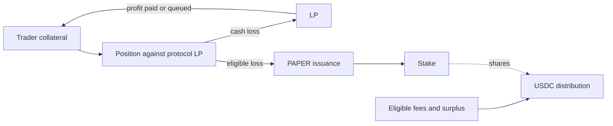

# Papertrade baseline

[中文](papertrade.zh-CN.md) · [Comparison](../README.md)

Observation date: 28 October 2026. This dossier reuses the repository's existing set-2 research and records this run's failed fresh documentation retrieval. It does not claim a new settlement reproduction.

## Trading underlyings and settlement

BTC, ETH; USDC collateral and trade settlement. The current official FAQ was reopened this turn. HIP-3 listing capability is not a current extra market. [Full inventory and source scope](../markets.md).

## Identity and chronology

Papertrade is the benchmark, not one of the competitors. The established product uses HyperEVM for contract state and HyperCore-related USDC infrastructure and price inputs. The research baseline is [commit d3fba1e](https://github.com/KoNit-K/papertrade-research/tree/d3fba1edd93d2fb1d492c0cdbe26dcf6fffa0050), particularly the [product review](../../current-product-review.md) and [version note](../../research-notes/016-2026-10-28-sync.md). Evidence: **EVD-COMP-PAPERTRADE-BASELINE**.

The official documentation read during planning labels set 1 as 7–21 October and set 2 as current since 21 October 2026. These are documentation version intervals, not independently established first-trade dates (**EVD-COMP-PAPERTRADE-PREFLIGHT**). Reports and launch-plan search results point to 10 October for frontend trading, but this investigation has not directly verified the original announcement or first trade. Exact public-beta and first-trade timestamps remain unknown.

The local baseline discusses the project's public pseudonymous administrators and control roles. This increment has not independently verified founders' legal names, operating entity, jurisdiction, employment histories, capital providers or financing. Those fields remain unknown. No token allocation is not proof of no company financing.

[Bankless and The Defiant launch reports](../../business-snapshot.md) support October 10 trading and the announced 14:00 UTC / 22:00 Shanghai schedule; this does not establish the first executed transaction. Contract set 1's October 7 date and set 2's October 21 date describe versions, not the same event. New manuscript business tables are explicitly provisional where original queries are missing; the existing source snapshot remains unchanged.

## Mechanism used for comparison

The existing review describes isolated high-leverage positions against the protocol LP; prices based on HyperCore bid/ask midpoint; relayed order submission; and a separate payment queue after settlement. Eligible losses mint PAPER, with supply-relative issuance in set 2 and a conditional insolvency multiplier. PAPER staking can receive USDC distributions. The current transfer restriction and the timing/permissions of distribution matter to that benefit.

The baseline distinguishes zero opening/funding fees from adjusted profit and the winning fee, with additional builder accounting where applicable. It also distinguishes user cash, position collateral, LP book balance, earned rewards and unpaid claims. These are separate quantities and must not be replaced by a single TVL number. See the existing review for the scope and gaps of each claim rather than inheriting a label of independent reproduction.

## Business data and limits

The refresh tool collects only explicitly supported public aggregate sources. DefiLlama's Papertrade TVL methodology includes the Exchange's HyperCore spot USDC balance, which can contain user funds as well as house capital. It is not pure bankroll. Its historical counter adapter treats protocol-history columns as cumulative values; a bucket at `t` represents `t + interval`, so flow windows require the correct two endpoints. Changes in cumulative users are new recorded wallets, not active wallets.

This execution's official documentation GET returned HTTP 403 at approximately 01:30:56 UTC on 28 October and that host's direct collection stopped (**EVD-COMP-PAPERTRADE-001**). The official stats domain was separately blocked in the data-source preflight. Historical or third-party values do not establish current official API availability. Actual aggregate observations and their timestamps are in the [metrics snapshot](../../../research/competitors/snapshots/latest.json); unavailable items remain null.

## Open questions

- Verify the original frontend-launch announcement and earliest executed public trade separately from contract-version dates.
- Obtain compatible official balances, OI, unpaid claims and timestamped history without credentials or access-control workarounds.
- Reconcile provider-defined fees and volume with the current set-2 mechanisms before making cross-product totals.
- Preserve the existing unresolved settlement and archival-state questions; this competitor study does not close them.

[Source metadata](../../../research/competitors/sources/papertrade.json) · [Existing full review](../../current-product-review.md)

## Public basics, builders and community clues

Docs cap BTC/ETH at1000x; the selected BTC slider shows1–1000x. HONKAYO/MONI tentatively identifies Jez as ColinHong; WPT separately records Hong’s MIT/MorganStanley/StandardCrypto history, without establishing the alias. A BidClub transcript attributes2017onchain exploration, a2021NewYork meeting with Jez and a2–3person build to Blurr. No headquarters, nationality or institutional financing is inferred.

[Basic facts and leverage tiers](../basics.md) · [Background sources and access status](../backgrounds.md) · [Real screenshots and evidence IDs](../browser-checks.md). These additions do not close legal-identity, first-fill or deployed-parameter gaps.
