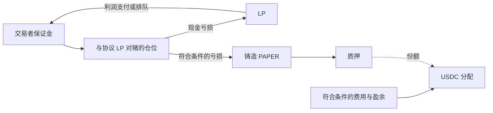

# Papertrade 比较基准

[English](papertrade.md) · [综合比较](../README.zh-CN.md)

观察日期：2026年10月28日。本档案使用仓库已有的 set 2 研究，并记录本轮重新读取官方文档失败的结果，不新增结算复现结论。

## 交易标的与结算币

BTC、ETH；保证金和交易结算为USDC。本轮重新读取官方FAQ确认，支持扩展HIP-3不等于已上线其他市场。 [完整清单与来源范围](../markets.zh-CN.md)。

## 身份与时间线

Papertrade 是比较基准，不占竞品名额。已研究产品在 HyperEVM 记录合约状态，使用 HyperCore 相关 USDC 基础设施和价格输入。基准为[提交 d3fba1e](https://github.com/KoNit-K/papertrade-research/tree/d3fba1edd93d2fb1d492c0cdbe26dcf6fffa0050)，主要参考[产品综合报告](../../current-product-review.zh-CN.md)及[版本核验](../../research-notes/016-2026-10-28-sync.md)。证据：**EVD-COMP-PAPERTRADE-BASELINE**。

计划预检实际读到的官方文档将 set 1 标为2026年10月7–21日，set 2 标为10月21日起当前版本。这是文档版本区间，不是独立核定的首次成交日期（**EVD-COMP-PAPERTRADE-PREFLIGHT**）。媒体和上线计划检索线索指向10月10日前端开放交易，但本次未直接验证原始公告和首笔实盘。公开 beta 与首笔成交的精确时刻保持未知。

已有研究包含公开化名管理者及权限角色。本次未独立核实创始人法定姓名、运营实体、司法辖区、从业经历、出资方或融资，因此这些字段保持未知。没有团队代币分配不能证明公司从未融资。

[Bankless、The Defiant 等上线报道](../../business-snapshot.zh-CN.md)支持 10 月 10 日开放交易及公布的 UTC 14:00／北京时间 22:00 时间，不代表已核定首笔成交。Set 1 的 10 月 7 日和 set 2 的 10 月 21 日属于版本日期。新稿件业务表中缺原始查询的数值明确标为待核，不改写既有来源快照。

## 用于比较的机制

已有报告描述逐仓高杠杆、协议 LP 作对手方、HyperCore 最优买卖价中间值、relayer 提交订单，以及成交结算之后独立的付款队列。符合条件的亏损铸造 PAPER；set 2 按供应量发币，并在缺口条件下提供加成。质押 PAPER 可以参与 USDC 分配，转账限制和分配时机、权限会影响这项权益。

基准区分零开仓费/资金费与盈利调整、盈利手续费，并在适用时单列 builder 记账。用户现金、仓位保证金、LP 账面余额、已记奖励和未付债权分别研究，不能用一个 TVL 数字替代。每项证据范围和局限以已有报告为准，不继承为独立协议复现。

## 业务数据与限制

刷新工具只读取明确支持的公开聚合来源。DefiLlama 的 Papertrade TVL 使用 Exchange 的 HyperCore spot USDC 余额，可能同时包含用户资金和庄家资金，不能称为纯 bankroll。其历史适配器将协议历史列视为累计值，`t` 桶代表 `t + interval` 的状态，流量窗口必须使用正确的两个端点。累计用户数的增长是新增记录钱包，不是活跃钱包。

本轮官方文档 GET 在10月28日约01:30:56 UTC（北京时间09:30:56）返回403，随后停止该主机直连采集（**EVD-COMP-PAPERTRADE-001**）。数据预检中，官方统计域名也受阻。旧值或第三方值不能证明当前官方接口可用。实际聚合观测和时间戳见[指标快照](../../../research/competitors/snapshots/latest.json)，缺项保留 null。

## 待核问题

- 分别确认前端上线原始公告、最早公开成交和合约版本日期。
- 在无需凭证、无需绕过访问控制的前提下取得兼容的官方余额、OI、未付债权与时间序列。
- 将来源定义的费用和成交量与 set 2 机制对齐后，再考虑跨产品总量。
- 保留既有结算和历史状态问题，本次竞品研究不关闭它们。

[来源元数据](../../../research/competitors/sources/papertrade.json) · [已有完整报告](../../current-product-review.zh-CN.md)

## 基本信息、公开建设者及社区线索补充

文档BTC/ETH最高1000倍；本次BTC页面滑杆1—1000倍。社区HONKAYO／MONI将Jez疑似识别为Colin Hong；WPT另列后者MIT、Morgan Stanley及Standard Crypto历史履历，但未核实两人同一身份。Blurr在BidClub转录自述2017年开始链上探索、2021年纽约认识Jez、二三人开发。不是总部、国籍或机构出资证明。

[基本资料与分档杠杆](../basics.zh-CN.md) · [背景出处与读取状态](../backgrounds.zh-CN.md) · [真实截图与证据编号](../browser-checks.zh-CN.md)。新资料补足公开信息，未消除法定身份、精确首笔成交和实盘参数缺口。
