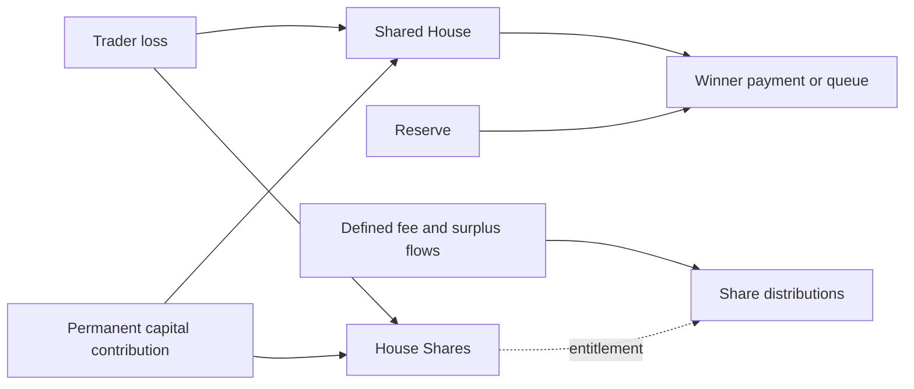

# STOX perps: adjacent House design

[中文](stox.zh-CN.md) · [Comparison](../README.md)

Observed: 28 October 2026, approximately 01:31–01:33 UTC. Classification: **adjacent mechanism comparison**, not an established Papertrade code fork. Evidence metadata: [stox.json](../../../research/competitors/sources/stox.json).

## Trading underlyings and settlement

The retained configuration contains 60 non-crypto entries across stocks, ETF, commodity, FX, index and intl, with USDG collateral/trade settlement. No crypto underlying is listed there. STOX/ETH distributions are separate; the config is not an independently verified live registry. [Full inventory and source scope](../markets.md).

## Identity and dates

The application at [stoxpreps.com](https://stoxpreps.com/) explicitly describes an independent synthetic trading protocol and disclaims affiliation with Robinhood Markets, Hyperliquid and the referenced issuers (**EVD-COMP-STOX-001**). It does not establish a legal operator, founder identity, jurisdiction or financing. Those items remain unknown. Running on Robinhood Chain does not make Robinhood its issuer.

Static JavaScript identifies Robinhood Chain **4663** and loads a public deployment configuration (**EVD-COMP-STOX-003**). The [configuration](https://stoxpreps.com/deployment.json) supplies Exchange `0xC8017e08CB5a8948D9cc9DED6D90f85bD813C382`, collateral and service addresses, `startBlock: 93027264`, and `launchTime: 1792455148` (**EVD-COMP-STOX-004**). The latter converts to **20 October 2026 00:12:28 UTC / 08:12:28 Beijing**. This is a frontend-configured timestamp, not an independently checked first trade, deployment receipt or current-v2 launch date. The page also describes migration from an earlier Exchange.

This dossier's social-account mirror GET returned 403 and its collection stopped. A separate scout retained a 200 response from the mirror later in the parallel session (**EVD-COMP-CANDIDATES-004**); both outcomes are preserved, and neither establishes original-post authenticity or first-trade timing. No further mirror request was made after integration. Search results for similarly named tokens and allegations were not used to identify this protocol or establish an event.

## Design differences

The frontend describes stock and other synthetic positions against a shared House, with USDG margin and up to 1,000x leverage subject to current capacity. It exposes partial closes and keeper-operated TP/SL, rather than YOLO's documented market-only full-close workflow. Displayed charges include a 0.5% opening charge and 2% of PnL, with balancing-related reductions. These are frontend descriptions; deployed accounting and effective settings were not replayed.

Eligible losses create nontransferable House Shares. The same shares can also be acquired through permanent USDG contributions to House capital. This differs from a loss-only issuance model: a deposit can increase both the pool and the contributor's distribution interest. The UI describes an additional Reserve and separate staking mechanics. Their availability, balances and cash-flow sufficiency were not independently measured.

## Business scale and evidence limits

The HTML shows labels for House balance, queued winners, OI, settlements and lifetime losses/payouts, but numeric values were placeholders. The initial HTML capture supplied no live values; placeholders are not zero. A later browser viewport displayed rounded selected-NVDA counters, recorded separately below and in the screenshot register; platform-wide scope and chain source remain unverified. Static code and the deployment file provide an integration path, but neither proves chain deployment or business activity. No private account or wallet query was made, and no contract execution was performed.

This dossier therefore supports a design comparison, not a ranking of market share or solvency. A future extension should first confirm the configured Exchange and version on the named chain, then obtain aggregate-only values with block/time bindings. It should not treat the configured `launchTime` as a verified first public trade.

## Open fields

Legal operator, founders, headquarters, financing, independently verified launch, current version deployment, trading volume, active wallets, bankroll, queue and realized paid PnL remain unknown. [Refresh guide](../refresh.md) explains the explicit unavailable-adapter result.

## Public basics, builders and community clues

The actual NVDA page now showsMAX1000x and a1–1000slider, beyond staticfallback evidence. Effective contract limits and other markets remain unverified. The project-feed mirror amplifies @Iplaychart1’s founder/lead-developer self-claim, with @STOX handle-scope ambiguity. @LAPOSSCRYPT is a community commentator, not assigned team membership. The unsigned Bitget five-person/Mei biography lacks primary support and remains a weak lead.

[Basic facts and leverage tiers](../basics.md) · [Background sources and access status](../backgrounds.md) · [Real screenshots and evidence IDs](../browser-checks.md). These additions do not close legal-identity, first-fill or deployed-parameter gaps.
