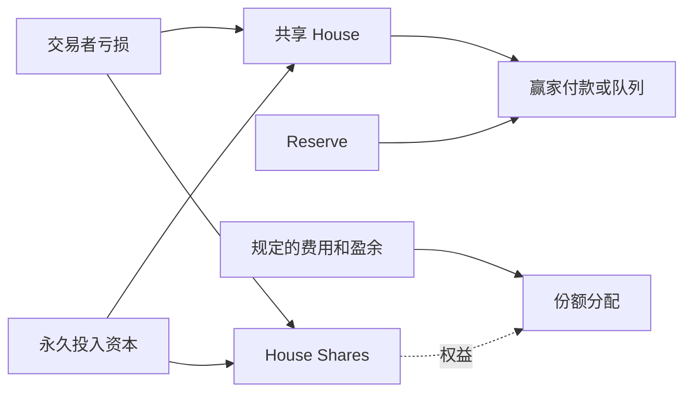

# STOX perps：相邻的庄家池设计

[English](stox.md) · [综合比较](../README.zh-CN.md)

观察时间：2026年10月28日约01:31–01:33 UTC（北京时间09:31–09:33）。分类为**相邻机制对照**，未证明它是 Papertrade 代码 fork。[来源元数据](../../../research/competitors/sources/stox.json)。

## 交易标的与结算币

保留配置含60条非加密资产，分stocks、ETF、commodity、FX、index、intl；保证金/交易结算为USDG，没有加密币交易标的。STOX/ETH分配另计，配置不是独立验证的实时市场登记。 [完整清单与来源范围](../markets.zh-CN.md)。

## 身份与日期

[stoxpreps.com](https://stoxpreps.com/) 页面称其为独立的合成交易协议，并声明不隶属于 Robinhood Markets、Hyperliquid 或标的发行方（**EVD-COMP-STOX-001**）。页面未建立法定运营者、创始人身份、司法辖区或融资信息，这些保持未知。在 Robinhood Chain 运行不意味着 Robinhood 是发行方。

静态 JavaScript 指向 Robinhood Chain **4663** 并加载公开部署配置（**EVD-COMP-STOX-003**）。[配置文件](https://stoxpreps.com/deployment.json)给出 Exchange `0xC8017e08CB5a8948D9cc9DED6D90f85bD813C382`、抵押品及服务地址，`startBlock: 93027264` 和 `launchTime: 1792455148`（**EVD-COMP-STOX-004**）。后者换算为**2026年10月20日00:12:28 UTC／北京时间08:12:28**。这是前端配置时间，没有独立核对首笔成交、部署回执或当前v2版本上线时间。页面也提示从旧 Exchange 迁移。

本档案的账号镜像GET返回403后停止采集。并行侦察任务稍后另行留存了镜像200响应（**EVD-COMP-CANDIDATES-004**）；两项结果均保留，都不证明原帖真实性或首笔成交时间。整合后没有继续请求该镜像。检索中出现的同名代币和指控未用于确认本产品身份或事件。

## 机制差异

前端描述用 USDG 保证金、共享 House 承担股票等合成仓位，最高1000倍并受容量约束。它提供部分平仓和 keeper 执行的止盈止损，与 YOLO 文档中的市价、整仓关闭流程不同。页面展示0.5%开仓收费及2%的盈亏收费，并说明平衡庄家风险的仓位可有减免；这些是前端描述，未重放部署合约的记账或核验有效参数。

符合条件的亏损生成不可转让的 House Shares，用户也可以通过永久投入 USDG 庄家资本取得同类份额。这区别于仅因亏损发币：存入资金能够同时增加池子和出资人的分配权益。界面还描述独立 Reserve 和质押机制，本次未独立测量其可用性、余额及现金流是否足够。

## 业务体量与证据限制

HTML 展示 House余额、欠付、OI、成交结算和累计亏损/支付等标签，但数值仍是占位符。初次HTML读取未取得数值，占位符不能补零；后续浏览器已显示所选NVDA的取整量/OI，见文末及截图记录，其全平台口径和链上来源仍未知。静态代码和配置提供后续接入线索，不能单独证明链上部署或业务活动。本次没有查询私人账户/钱包，也没有执行合约。

因此本档案支持产品设计比较，不支持市场份额或偿付能力排名。后续应先在指定链确认 Exchange 与版本，再取得绑定区块和时间的聚合数据；不能把 `launchTime` 直接当成已确认的首笔公开成交。

## 仍未知的字段

法定运营方、创始人、总部、融资、独立核验的上线时间、当前部署版本、成交量、活跃钱包、庄家资金、队列和已付实际PnL均保持未知。[刷新指南](../refresh.zh-CN.md)说明未支持适配器的明确返回结果。

## 基本信息、公开建设者及社区线索补充

本次NVDA实页显示MAX1000倍及1—1000滑杆，不再仅凭静态fallback给上限。实际市场合约参数和其余标的仍未核。项目feed镜像放大@Iplaychart1自称创始人／主要开发者的帖子，但帖子写@STOX存在范围歧义，属于本人自述线索。@LAPOSSCRYPT是社区评论者，不写成团队；Bitget无署名五人／Mei履历简介缺原始依据，仅低置信待核。

[基本资料与分档杠杆](../basics.zh-CN.md) · [背景出处与读取状态](../backgrounds.zh-CN.md) · [真实截图与证据编号](../browser-checks.zh-CN.md)。新资料补足公开信息，未消除法定身份、精确首笔成交和实盘参数缺口。
