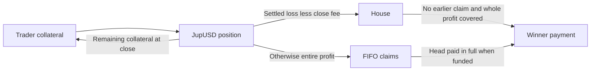

# Jupiter YOLO: competitor dossier

Reviewed **2026-10-28** · [中文](yolo.zh-CN.md) · [Source metadata](../../../research/competitors/sources/yolo.json).

**Status: partial evidence; official product description, not independently reproduced execution.** YOLO is a direct mechanism comparator for Papertrade: extreme leverage, a loss-funded House, nonlinear winning payouts and a payout queue. Its Solana distribution and JupUSD settlement differ from Papertrade's infrastructure. Shared mechanics do not establish shared ownership.

## Trading underlyings and settlement

SOL, BTC, ETH, ZEC, HYPE; JupUSD collateral and trade settlement. Other input tokens are swapped to JupUSD, not additional underlying markets. [Full inventory and source scope](../markets.md).

## Evidence and identity

Five official pages were fully read through a mediated reader during this conversation's October 28 preflight. Their exact retrieval times and raw responses were not retained: metadata uses `retrieved_at: null`, an observation date and no capture digest. A later direct overview request returned HTTP 403; collection from that host stopped. That separate denial does not erase the earlier reading or establish the current deployed version. New media captures are separately identified. Hashes identify retained response representations, not authenticity or independent verification.

| Field | Finding and boundary |
|---|---|
| Product / operator attribution | Jupiter YOLO, an experimental Jupiter Labs beta on `jup.ag/yolo`; distinct from Jupiter Perps and JLP. [001](https://docs.jup.ag/user-docs/labs/yolo) |
| Network / settlement | Documented Solana-wallet flow; JupUSD collateral and payments. Non-JupUSD payment is swapped within the opening transaction. [002](https://docs.jup.ag/user-docs/labs/yolo/trading) |
| Publicly named person | Media identifies Siong Ong as Jupiter co-founder; his [personal site](https://siong.com/) says he is building Jupiter. Detailed YOLO staffing and employment history: **null**. Sources 007, 016. |
| Contracting entity / domicile / operating geography | **null**; not established by acquired evidence. Neither a person's name nor the Solana network establishes jurisdiction. |
| Sponsor / initial bankroll provider / investors specific to YOLO | **null**. The rules describe replenishment from losses, not a guaranteed external backstop. |
| Program ID / deployed version / upgrade authority / audited version | **null**. Media calls the beta unaudited; no code/audit or onchain permission verification was performed. |

## Dates and relation to Papertrade

| Event | Evidence |
|---|---|
| Preannouncement | **null**; no earlier dated announcement established. |
| Public beta / real-money product announcement | October 15, 2026. A [mirror](https://teapawt.org/sssionggg/status/2110717157566988335) displays 12:59 UTC (20:59 Shanghai); [original](https://x.com/sssionggg/status/2110717157566988335) denied access. Media independently reports the date, not a deployment transaction. Sources 007, 009, 012. |
| Attribution to Papertrade | An October 16 [mirrored post](https://teapawt.org/sssionggg/status/2110903439467360645) credits Papertrade's payout-queue idea; [original](https://x.com/sssionggg/status/2110903439467360645) unavailable. Media repeats the attribution. Sources 007, 010, 013. |
| Production graduation / exact market-addition or program-upgrade date | **null**. October 28's official-page reading includes ZEC/HYPE; that does not date deployment. |

The attribution supports **acknowledged design inspiration**. It does not prove a commercial partnership, common team, funding, licensed code or a shared queue. In particular, YOLO's documented whole-claim FIFO must not inherit Papertrade's partial-payment behavior.

## Mechanism, funds and operational permissions

[Official overview](https://docs.jup.ag/user-docs/labs/yolo) describes 500–1,000× in 100× steps, long/short on SOL, BTC, ETH, ZEC and HYPE. The minimum is 5 JupUSD. Documented per-position notional limits are $1M on SOL/BTC/ETH and $250k on ZEC/HYPE, with separate mutable market-side capacity. These are descriptions; app values prevail. Source 001/002.

The diagram summarizes [payout rules](https://docs.jup.ag/user-docs/labs/yolo/payouts), not a verified account ledger. The House is separate from JLP and accepts no direct LP provision. Existing queued claims force new winning closes into the queue even when their individual amounts could be paid. No partial claim payment is described: a large queue head blocks later claims. Payment has no deadline and can fail to occur indefinitely. Claims pay automatically; claim-account SOL rent is returned when paid. Source 004.

[Trading documentation](https://docs.jup.ag/user-docs/labs/yolo/trading) separates indicative Pyth chart prices from execution at the onchain Pyth Pro price roughly two seconds after submission. Market orders have no price limit. Opens and manual closes require a Jupiter trade-service co-signature. No TP/SL, partial close or collateral modification is described. Earliest manual close is 15 seconds; liquidation can occur meanwhile. A keeper can close at 72 hours or the adjusted-profit cap without the trader's signature. Source 002.

The team can change fee/cap/duration settings; documentation does not establish the deployed authorization implementation or upgrade delay. A trading pause may stop opens and closes while liquidation remains possible; payout processing continues. Network/service/oracle/keeper availability therefore matters separately from House solvency. Sources [003](https://docs.jup.ag/user-docs/labs/yolo/profit-and-fees), [005](https://docs.jup.ag/user-docs/labs/yolo/risks), 004.

## Pricing, fees and rounding

The [official formula](https://docs.jup.ag/user-docs/labs/yolo/profit-and-fees) describes this order for a favorable move `m`, entry-relative fraction, not percentage points:

1. Deadband: no profit for `m <= 0.00002` (0.2 basis points).
2. Otherwise `d = m - 0.00002`, `c = 1983979 / 7259685000`; adjusted profit is `0.9 × notional × d² / (d + c)`.
3. Cap adjusted profit at `50 × collateral`, then subtract its 2% win fee.
4. Every close or liquidation also takes `0.00002 × notional` from collateral.

Profit and fees round down, losses up, to 0.000001 JupUSD. Losses use the full adverse linear move plus close fee, capped by collateral. Consequently the documented 1,000× bust distance is 0.098%, rather than exactly 0.1%. The cap is before the win fee and triggers automatic closing. There is no opening/funding/holding fee in this description; network, swap and claim-rent costs remain separate. Source 003/002. This is an original restatement of documented arithmetic, not a program-derived calculator or historical settlement test.

## Business scale and observability

The [$1B original-post locator](https://x.com/JupiterExchange/status/2111040151761850723) was recovered from newly captured [SolanaFloor HTML](https://solanafloor.com/news/is-jupiter-s-yolo-solana-s-answer-to-papertrade). The October 16 article attributes sub-24-hour volume to Jupiter and explains it as leveraged notional on opens and closes. It is an **issuer claim relayed by media**, not verified cash deposits, TVL, revenue, active users or independent event totals. Original complete post content/time remains unverified. Sources 007/011. [The Defiant](https://thedefiant.io/news/defi/jupiter-says-yolo-hit-1-billion-in-volume-in-under-24-hours) returned a title, subtitle and loading placeholder only; its full article was **not read** (014).

[Official leaderboard documentation](https://docs.jup.ag/user-docs/labs/yolo/trading) describes wallet rankings across 24H, 7D and All time: realized PnL on closed trades; notional volume counting opens and closes; or longest single completed holding duration. It describes updates following closes, trader detail pages and wallet connection for one's own rank. It does **not** establish our access to complete historical coverage, pagination, realized-but-unpaid PnL treatment, tie-breaks, bot filtering or fee inclusion. Source 002.

No live first-party leaderboard rows, product API schema, wallet totals, current House assets, queued liability, official fee ledger or transaction count were captured. The execution-phase browser inventory was empty and browser creation returned unavailable (017). Preflight page access also failed. The owner-supplied bankroll/queue example has no observation time and is excluded from current metrics. A zero queue alone would not establish resilience to future winners.

The separate data workstream obtained DefiLlama's provider-defined winning-profit fees: $4,650 for its reported 24h window, $48,332 for 7d, and $83,051.25 cumulative. These are third-party aggregate assertions with unspecified exact window boundaries, not a complete official cost ledger or volume measure. Its adapter does not export volume and does not measure the documented close-notional charge. See the [reviewed snapshot](../../../research/competitors/snapshots/latest.json) and [metrics source metadata](../../../research/competitors/sources/metrics.json).

## Source register and remaining work

| IDs | Read / captured scope |
|---|---|
| 001–005 | Official pages: full preflight reading; exact time/raw bytes absent; no fresh deployment binding. |
| 006 | New HTTP403 response captured and SHA-256 recorded; host stopped. |
| 007 | New SolanaFloor full article and HTTP200 HTML, SHA-256 recorded; derivative claims. |
| 009–011 | Original X locators; original content unavailable; 011 extracted without a new X request. |
| 012–013 | Full preflight mirror reading; authentic publisher response not verified. |
| 014 | New partial The Defiant reader response; article body unavailable. |
| 015–016 | New derivative guide and personal-site reader responses, hashed; not deployment evidence. |
| 017–019 | Browser unavailable and execution-phase mirror reader errors; no market data. |

Next bounded collection should first restore an ordinary anonymous browser, capture dated House/queue values and all advertised leaderboard windows, and document actual public requests without probing private routes. Before profitability, solvency or permission conclusions, identify the program/version, oracle inputs, settings and complete execution/claim event semantics. Confirm whether leaderboard PnL recognizes queued claims before payment. Legal entity, team roles, initial funding and an independently versioned audit remain open. No signing, trades, funding, credentials, outreach, commits or pushes occurred in this dossier work.

## Public basics, builders and community clues

Official docs describe500–1000x in100x steps; the overview screenshot confirms the displayed range only. Public biographies tie Meow/Siong to the historical Jupiter/Mercurial/Meteora builder network; Siong’s early engineering history is from an old Mercurial team page, Meow’s from his personal site. Jupiter terms name BlockRaccoonS.A. and Panama law for the interface; this is not a separate YOLO entity or developer-location finding.

[Basic facts and leverage tiers](../basics.md) · [Background sources and access status](../backgrounds.md) · [Real screenshots and evidence IDs](../browser-checks.md). These additions do not close legal-identity, first-fill or deployed-parameter gaps.
