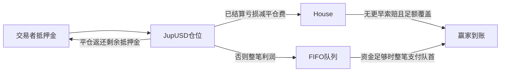

# Jupiter YOLO：竞品档案

审阅日期：**2026-10-28** · [English](yolo.md) · [来源元数据](../../../research/competitors/sources/yolo.json)。

**状态：证据部分完整；属于官方描述研究，尚未独立复现执行。** YOLO 是 Papertrade 必须纳入的直接机制竞品：超高杠杆、亏损补充 House、非线性盈利与兑付队列相近；Solana 分发和 JupUSD 结算不同。机制相似不等于共同所有权。

## 交易标的与结算币

SOL、BTC、ETH、ZEC、HYPE；保证金和交易结算为JupUSD。其他输入代币先兑换成JupUSD，不是额外合约标的。 [完整清单与来源范围](../markets.zh-CN.md)。

## 证据边界与身份

本对话10月28日预检阶段通过页面读取器完整读过五篇官方文档，但未保留精确读取时间和响应原始字节。对应记录使用 `retrieved_at: null`、观察日期、空摘要值；不能冒充本轮新采集。本轮直接请求官方总览返回403，随即停止该主机采集。新失败不抹去先前阅读，也不能证明部署版本。新媒体材料单独标识；SHA-256只能绑定保留的响应表示，不能证明真实性或协议已复现。

| 字段 | 发现及限制 |
|---|---|
| 产品与运营归属 | Jupiter YOLO，Jupiter Labs 的实验性 beta；与 Jupiter Perps、JLP 分开。[001](https://docs.jup.ag/user-docs/labs/yolo) |
| 网络与结算 | 文档描述 Solana 钱包、JupUSD 抵押及支付，其他代币在开仓交易中换成 JupUSD。[002](https://docs.jup.ag/user-docs/labs/yolo/trading) |
| 公开人物与履历 | 媒体称 Siong Ong 为 Jupiter 联合创始人；[个人官网](https://siong.com/)自述正在建设 Jupiter。YOLO 具体人员、职责及详细履历：**null**。007、016。 |
| 签约实体、注册地、实际运营地域 | **null**。个人姓名或所用公链不构成司法辖区证据。 |
| YOLO 专项投资方、赞助方、初始底池出资方 | **null**。亏损补池规则不是外部兜底承诺。 |
| 程序地址、部署版本、升级权限、审计版本 | **null**。媒体称未审计；本轮未核对代码、审计或链上权限。 |

## 时间与 Papertrade 关系

| 事件 | 可查证据 |
|---|---|
| 公开预告 | **null**，未建立更早日期。 |
| 公开 beta／真金白银产品宣布 | 2026-10-15。[镜像](https://teapawt.org/sssionggg/status/2110717157566988335)显示12:59 UTC，即上海20:59；[原帖](https://x.com/sssionggg/status/2110717157566988335)拒绝访问。媒体另有日期报道，不能替代部署交易时间。007、009、012。 |
| 向 Papertrade 致谢 | 10月16日[镜像帖](https://teapawt.org/sssionggg/status/2110903439467360645)把兑付队列灵感归于 Papertrade；[原帖](https://x.com/sssionggg/status/2110903439467360645)不可读。媒体重复该归因。007、010、013。 |
| 正式版毕业、具体市场上线或程序升级时间 | **null**。10月28日读到 ZEC/HYPE，不足以确定部署日。 |

因此可以写“公开承认借鉴设计”，不能推断合作、共同团队、融资、授权代码或共享队列。尤其不能把 Papertrade 的部分付款机制直接套到 YOLO 整笔兑付上。

## 机制、资金流与运营权限

[官方总览](https://docs.jup.ag/user-docs/labs/yolo)描述 SOL/BTC/ETH/ZEC/HYPE 多空，500–1000倍、每档100倍，最低5 JupUSD。文档名义仓位上限：SOL/BTC/ETH 每仓100万美元，ZEC/HYPE 每仓25万美元；市场多空容量分开且可变。这是来源描述，应用显示优先。001、002。

这是[官方支付规则](https://docs.jup.ag/user-docs/labs/yolo/payouts)的解释图，不是已核对的账户账本。House 不使用 JLP，也不接受直接 LP 存款。队列存在时，新利润一律入队；按先后整笔支付，不能部分兑付，大额队首可能阻塞后续。无期限保证，甚至永不支付。利润索赔账户需要少量 SOL 租金，付款时退回。004。

[交易文档](https://docs.jup.ag/user-docs/labs/yolo/trading)区分 Pyth 图示参考价和提交约2秒后的链上 Pyth Pro 执行价。市价单无限价保护；开仓、手动平仓需要 Jupiter 交易服务共同签署。文档未描述 TP/SL、部分平仓或追加抵押金。最早15秒手动关闭，期间仍可清算；72小时或达到调整利润上限时 keeper 无须交易者签字自动关闭。002。

团队可改费率、上限和时限，但部署授权实现、升级延迟未知。暂停可能同时禁止开平仓而继续清算；兑付仍继续。交易服务、网络、预言机和 keeper 可用性，与 House 资金充足是不同边界。[003](https://docs.jup.ag/user-docs/labs/yolo/profit-and-fees)、[005](https://docs.jup.ag/user-docs/labs/yolo/risks)、004。

## 计价、费用顺序与舍入

[官方费用页](https://docs.jup.ag/user-docs/labs/yolo/profit-and-fees)中，`m` 为有利变动相对入场价的比例，计算顺序为：

1. `m≤0.00002` 即0.2基点时，利润为零。
2. 否则 `d=m−0.00002`，`c=1983979/7259685000`；调整利润为 `0.9×名义仓位×d²/(d+c)`。
3. 先以抵押金50倍封顶，再扣调整利润的2%。
4. 每次关闭、清算另从抵押金扣 `0.00002×名义仓位`。

利润、费用向下，亏损向上舍入至0.000001 JupUSD。亏损按完整不利线性变动加平仓费，最高损失抵押金。因此文档1000倍清算距离为0.098%，并非精确0.1%。50倍上限在盈利费之前，达到时触发自动关闭。描述中没有开仓、资金或持仓费；网络、兑换和索赔租金成本另计。003、002。这里是文档算式的原创整理，不是程序反推计算器或历史结算复现。

## 业务规模与可观测范围

本轮新获取的 [SolanaFloor HTML](https://solanafloor.com/news/is-jupiter-s-yolo-solana-s-answer-to-papertrade)包含[$1B原帖地址](https://x.com/JupiterExchange/status/2111040151761850723)。10月16日文章把“不足24小时10亿美元成交量”归于 Jupiter，并解释为开平仓的杠杆名义金额。它是**媒体转述的发行方主张**，不是独立核对的充值额、TVL、收入、用户数或完整链上事件合计。原帖完整内容与精确时间仍未直接验证。007、011。[The Defiant](https://thedefiant.io/news/defi/jupiter-says-yolo-hit-1-billion-in-volume-in-under-24-hours)仅返回标题、副标题与加载占位，**未读到全文**。014。

[官方榜单描述](https://docs.jup.ag/user-docs/labs/yolo/trading)覆盖24H、7D、All time三窗口；按已关闭交易的已实现PnL、开平仓名义成交量、单仓最长完成持仓时间排名，关闭后更新，支持交易者详情；查看自己的排名要求连接钱包。文档未给出我们的完整历史覆盖、分页、已实现未支付PnL处理、并列顺序、机器人过滤或费用计入口径。002。

本轮未捕获官方一方的实时榜单行、产品API结构、钱包总量、当前House资产、排队负债、官方费用账本或交易笔数。浏览器清单为空，创建浏览器返回不可用（017）；预检页面读取也失败。用户给的底池/队列示例没有时点，不纳入当前业务指标。零队列本身不证明未来支付韧性。

独立数据任务取得DefiLlama定义的盈利手续费：来源24小时窗口$4,650、7天$48,332、累计$83,051.25。这些是未给出精确窗口边界的第三方聚合自报，不是完整官方成本账本，也不是成交量。其适配器没有输出成交量，也未衡量文档中的平仓名义额收费。见[审阅快照](../../../research/competitors/snapshots/latest.json)和[统计来源元数据](../../../research/competitors/sources/metrics.json)。

## 来源表与缺口

| 编号 | 实际读取／采集边界 |
|---|---|
| 001–005 | 预检完整读取官方五页；缺精确时点、原始字节及部署绑定。 |
| 006 | 本轮403响应已保存并记录SHA-256，随后停读该主机。 |
| 007 | 本轮媒体全文及HTTP200 HTML，保存SHA-256；仍是转述来源。 |
| 009–011 | 原始X地址；原站不可读，011只从文章提取，未新增X请求。 |
| 012–013 | 预检完整读取镜像；未独立认证原发布者响应。 |
| 014 | 本轮The Defiant部分响应，正文不可读。 |
| 015–016 | 本轮第三方指南及个人站读取器响应有hash，不是部署证据。 |
| 017–019 | 浏览器不可用及本轮镜像读取失败，未取得市场数据。 |

后续应先恢复正常匿名浏览器，采集带UTC时点的House/队列和各榜单窗口，再记录页面真实公开请求，不探测私有路由。盈利、偿付及权限结论必须先绑定程序版本、价格输入、参数及完整执行/索赔事件语义；特别核对排队利润是否在实际到账前进入榜单PnL。法律实体、人员职责、初始资金与版本化独立审计仍待查。本档案工作没有签名、交易、充值、凭据、外联、提交或推送。
