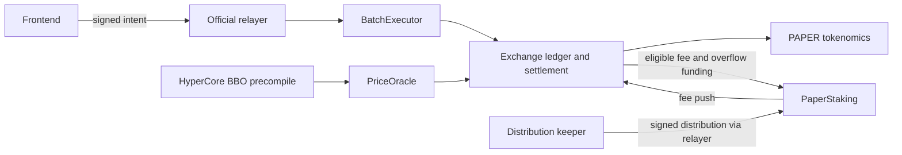
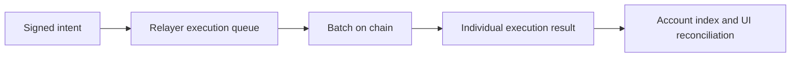
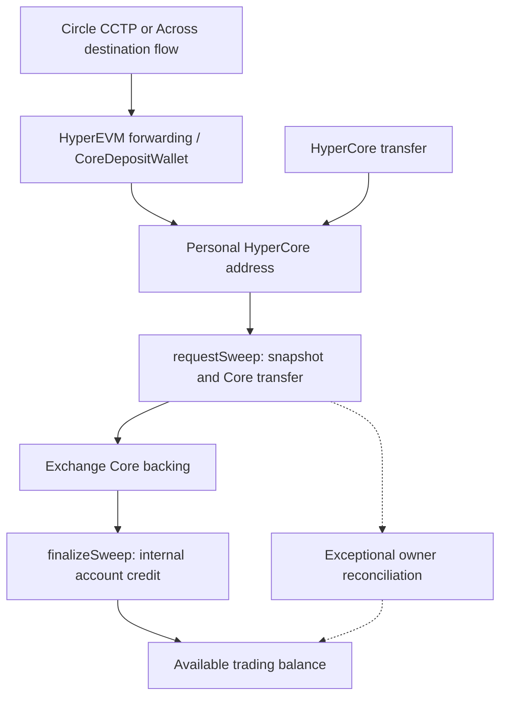
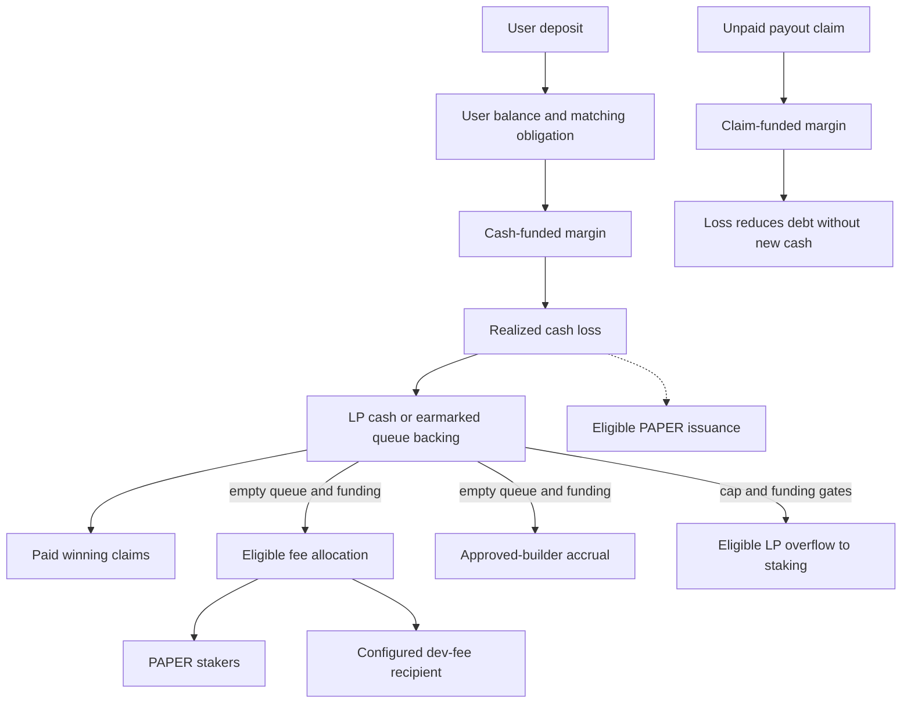

# Papertrade: product, settlement, services and business model

[Mechanism/funding follow-up · 机制与资金补充](research-notes/018-mechanism-funding-and-authority.md).

Reviewed: **2026-10-28**. [中文](current-product-review.zh-CN.md) · [Confirmed updates and evidence](research-notes/016-2026-10-28-sync.md).

This review explains **documented Contract set 2**, rather than a live market-parameter snapshot. Official-page evidence comes from successful mediated page readings on October 28, including a [responsiveness and queue follow-up](research-notes/017-responsiveness-and-queue-stages.md). Implementation references are the repository's dated client captures; vendor documentation is additional evidence about vendor capabilities. The upgrade transaction has separate receipt/block evidence. These evidence types are not interchangeable.

**2026-10-30:** [Manuscript reconciliation / 稿件核验](research-notes/019-manuscript-reconciliation.md). October 28 source/version boundaries remain in force; this is a documentation update, not a new deployment certification.

## Product and design

Papertrade offers leveraged synthetic exposure settled against a protocol pool. Hyperliquid supplies the price reference; Papertrade does not place an equivalent Hyperliquid perpetual order for every position. Its design combines a small trading form, session-key signing, relayer-paid trade gas, BBO-mid execution, loss-funded liquidity and a token that shares future distributions. [Official introduction](https://docs.papertrade.xyz/).

The intended product loop is: fund a trading balance → authorize trading → open separate positions → close or be liquidated → receive cash/claims and possibly PAPER → stake PAPER → claim allocated USDC → withdraw. A winning close, a claimable balance and money received outside the platform are separate outcomes.

The previously inspected client used whole-position closes and separate long/short positions. Its captured opening and closing signatures did not establish native limit orders, TP/SL or an amount-based partial close. Those observations remain bound to the [captured client version](research-notes/012-independent-clients-orders-and-bridges.md#position-management-and-order-types). The advertised 1000× ceiling is not a current per-market admission guarantee.

**Design interpretation:** precompile pricing avoids running a separate matching engine; charging against successful outcomes makes extreme leverage usable without a notional fee consuming margin immediately. Loss-based issuance encourages users to supply the pool's risk capital indirectly. This also couples trader incentives, token dilution and future loss flow: PAPER issuance itself supplies no USDC.

### Order books, pool-based perpetuals and synthetic settlement

This compares settlement structures, not a universal leverage or fee schedule. Pool-based DEXs vary by product and version; an old GLP model does not represent every GMX market.

| Dimension | CEX / onchain order-book perps | Pool-based perpetual DEXs | Papertrade, documented set 2 |
|---|---|---|---|
| Counterparty | Matched buy/sell orders with venue risk controls | Pool bears trader PnL under its rules | Protocol LP bears synthetic PnL |
| Pricing | Matched fills; mark/index have distinct roles | Oracle/index plus product-specific price impact | Read-only HyperCore BBO midpoint |
| Leverage | Market, tier and risk configuration | Protocol and market configuration | Advertised up to 1000×, subject to admission capacity |
| Carry cost | Usually funding, with product-specific intervals | Borrowing/funding rules vary by version | No funding; profit adjustment and exit charges remain |
| Open/close fees | Maker/taker, tier and order type | Trading and impact rules vary | Zero opening fee; adjusted winning PnL normally pays 2% |
| Liquidation | Venue mark/margin/risk rules | Oracle/margin and keeper paths | Buffered bust trigger forfeits full isolated margin |
| Custody/execution | CEX custody or onchain ledger | Contracts, with upgrade/operator boundaries | Contract ledger; permitted batch path for ordinary trades |
| Token incentives | Usually not issued directly per losing trade | LP shares normally represent risk-bearing capital | Eligible losses mint PAPER; staking shares funded distributions |
| Trading use | Hedging and directional exposure, depending on features | Similar, subject to pool limits | Extreme-leverage synthetic exposure and loss incentives |

Papertrade submits no corresponding order to HyperCore, so that trade leg has no direct order-book fill impact. External hedging or arbitrage can still affect the reference market. A CFD-like comparison describes cash-difference settlement, not a legal classification. Pool-based products need not hedge every trade externally. Funding intervals also differ: [Hyperliquid documents hourly payments](https://hyperliquid.gitbook.io/hyperliquid-docs/trading/funding), not a universal eight-hour schedule.

## Pricing risk and market controls

The [pricing description](https://docs.papertrade.xyz/how/pricing-bbo/) rejects zero quotes and crossed books (`ask < bid`), but describes no maximum-deviation, TWAP or lookback breaker. Reading consensus state authenticates the quoted book; it does not establish that the quote is economically undistorted. Deadband, impact and OI controls can constrain payoffs or exposure without proving manipulation unprofitable.

[Guardian's October 9 review](https://www.guardian.security/portfolio/papertrade/protocol-review-2026-10-09/) lists BBO manipulation as **KV-01, a known design vector**, outside its finding count; this does not mean it is eliminated. [CertiK's October 20 analysis](https://www-cn.certik.com/blog/papertrade-bbo-pricing-incident) describes project-reported attempts on October 10–11 and an examined account withdrawing **1,279,106.191184 USDC** more than it deposited. That is not proven attack profit, aggregate LP loss or net profit after external trading costs. Quote consumption and temporal overlap alone do not prove price distortion. This review read the analysis without replaying its transactions.

| Control | Opens | Existing closes and liquidations | Restoration |
|---|---|---|---|
| Guardian retires one market ID | Rejected for that ID | Use the bid/ask frozen at retirement | Permanent for that ID; a relist needs a new ID |
| Guardian engages global trading pause | Rejected across markets | Continue using live BBO | Owner can lift the gate |
| Market keeper lowers a side's OI cap | Opens exceeding that cap fail | Live BBO continues | Changing the cap does not retire the market |

The [risk page](https://docs.papertrade.xyz/how/risk/) scopes market-keeper authority to directional OI caps and opening minimums; the off-hours keeper selects between two fixed payout curves. Owner authority covers parameters, relayers/keepers, listings, exceptional deposit reconciliation and upgrades. Builder approval/rate changes use governance; the multisig can remove a builder immediately. The documented launch cap policy targets each side's existing OI **plus $1B of BBO-valued headroom**, adjusted outside a 10% band. That is an operating policy, not a verified current value, a total-OI ceiling or a maximum-loss guarantee.

These are set-2 documentation statements. Current storage, operator responsiveness and upgrade-remediation equivalence are separate verification questions.

## Settlement and the meaning of trading cost

The [documented winning-close calculation](https://docs.papertrade.xyz/how/asymmetric-impact/) is:

1. Remove the first 0.2 bps of favorable price movement (the deadband).
2. Apply the selected small-move holdback.
3. Scale the resulting gain using asymmetric impact.
4. Deduct the win fee from that scaled gain; funding determines whether recipients can accrue it.

The standard holdback band is **0.75–6 bps**; the off-hours band is **0.3–10 bps**. A dedicated keeper selects between the two contract-defined curves. The percentage impact uses a per-market reference notional, not the user's position size. Consequently, execution at the same midpoint can coexist with substantial deductions from a small gross gain. “No slippage” is not a promise to receive raw leveraged PnL.

| Outcome / participant | Documented treatment |
|---|---|
| Ordinary winning close | After price adjustments and impact, the normal 2% win fee leaves 98% of scaled profit. |
| Approved builder on that winning branch | Another 0.5% of scaled profit leaves 97.5%; this is not 2.5% of notional. |
| Losing trader | No charge is added on top of the realized loss. LP-side fees can still reduce what the pool retains and what counts for minting. |
| Builder on a losing close | Its applicable 0.5% comes from the LP's gain and is excluded from PAPER basis. |
| Liquidation, including a close at/past bust | No builder fee. Contract-set-2 hard liquidation must be distinguished from an ordinary loss close. |

Builder accrual requires an empty payout queue and enough LP funding. On a winning close the extra trader deduction still applies if that builder-credit condition fails; it remains with the LP. The official frontend names no builder. Builder fee claims credit Exchange balance; an uncovered part can enter the payout queue. Approval and rate changes use the timelock, the rate is capped at 1%, and the multisig can remove a builder immediately. [Official builder rules](https://docs.papertrade.xyz/how/builder-codes/).

The ordinary win example does not replace branch-specific cash/debt and fee-waiver accounting. The [existing ledger research](research-notes/011-loss-governance-staking-and-payments.md#1-why-equal-losses-can-produce-different-paper-amounts) keeps those distinctions. Liquidation also has a buffered trigger and a zero-equity boundary; the [existing formula analysis](research-notes/006-current-mechanisms.md#liquidation-exact-buffer-basis-and-inclusive-threshold) must be read with its version and rounding scope.

### Cash, debt and outcome branches

Here `M` is margin, `L` realized loss and `G` positive gain after deadband, holdback and impact. Ordinary winning net profit is `0.98G`, or `0.975G` with the documented approved builder. This is a conceptual [set-2 table](https://docs.papertrade.xyz/how/solvency-queue/), not an integer replay.

| Margin / outcome | Balance or claim | Cash and fees |
|---|---|---|
| Cash / win | Return `M`; pay allowed net profit and queue the remainder. Earlier claims make all new profit queue. | Trader deduction and funded fee allocation are separate. |
| Debt / win | `M + net profit` survives as an obligation, paid or queued under the gates. | Reusing debt supplied no new cash. |
| Favorable move erased by deadband | No positive adjusted gain: cash margin returns; debt margin remains a claim. | A favorable raw quote does not guarantee positive net profit. |
| Cash / loss, empty queue | Return `M-L`; LP retains net loss proceeds. | Applicable loss fees come from LP gain, not an extra trader debit. |
| Cash / loss, active queue | Return `M-L`; loss cash backs old claims through `sideBucket`. | Loss fees are waived; PAPER eligibility is calculated separately. |
| Debt / loss | Destroy `L`; pay or queue survivor `M-L`. | No cash inflow. Normal loss fee requires empty queue and funding for survivor plus fee; builder has a funding gate too. |
| Cash / hard liquidation | Full margin lost. | Cash backs LP/old claims; queue state affects liquidation fees. No builder. |
| Debt / hard liquidation | Entire margin claim destroyed. | No new cash/sideBucket; no liquidation or builder fee. |

For a **teaching 4-bps favorable move**, the documented formulas yield holdback of about **1.05024 bps standard** or **2.03250 bps off-hours**. After the 0.2-bps deadband, effective moves are about 2.74976 or 1.76750 bps, before impact and fees. This is decimal arithmetic, not a current parameter snapshot or Solidity rounding. A synthetic already-scaled gain of 100 leaves 98 or 97.5 before returned margin. Exact combined fee-funding order is not inferred.

### Keeper execution and the 1000× distance

A price crossing does not execute a contract by itself. An external keeper submits a transaction; Exchange rereads execution-time BBO and checks the boundary. An ordinary close at the boundary also becomes hard liquidation. Previously acquired official descriptions say protocol keepers use higher priority fees, while liquidation is a public maintenance path. Priority fees do not guarantee ordering or establish the principal cause of order delays without transaction-level measurement.

Ignoring integer rounding and assuming an exact 5bps buffer, a 1000× long triggers at `E × (1−1/1000) × (1+0.0005)`, about **0.05005%** adverse movement; a short is about **0.04995%**. Use **about 0.05%** in the explanation. The reported 0.052% is an attributed approximation, not the exact result of this assumption. Parameters, quote precision, rounding and direction determine the actual trigger.

## Liquidity, PAPER and distribution

There is no ordinary direct LP-deposit path in the documented model. Cash losses fund the pool; winning obligations that cannot be paid become queued claims. A claim-funded position reuses a liability, so a loss on it is not new cash arriving from outside. FIFO ordering provides priority, not a payment deadline. [Introduction](https://docs.papertrade.xyz/) · [Cash/claim research](research-notes/007-queue-and-dividend-payment.md).

Current documented issuance depends on existing PAPER supply. During negative tracked LP, only the eligible loss portion filling the deficit receives the time-based bonus, up to 5× after three days. For illustration, an eligible basis of 100, deficit of 30 and multiplier of 5 gives weighted basis **30 × 5 + 70 = 220**, not 500. This starts with an already-eligible basis; it does not reconstruct fee deductions or Solidity rounding.

The stated revenue sources for stakers are the applicable 1% share of settled gains/losses when queue and funding conditions permit, and LP gains distributable above the documented $5M reward cap. Debt-funded liquidation is an exception. PAPER is initially transferable only through the allowed staking path; token supply and a holder's distribution entitlement are different quantities. [Official introduction](https://docs.papertrade.xyz/).

The [staking documentation](https://docs.papertrade.xyz/paper/staking/) describes signed stake/unstake/claim delivery through the relayer and keeper-signed distribution. PaperStaking alone may push Exchange staker fees; distribution then advances `accRewardPerShare`. `pendingReward` includes already distributed rewards. Unstaking has no cooldown and preserves accrued rewards. Allocation depends on stake at distribution, so holding time alone is not an additional weighting rule.

### Issuance change and proportional dilution

| Item | Contract set 1, documented October 7–21 | Contract set 2, documented from October 21 |
|---|---|---|
| Base rule | About 100 PAPER/$ in the low-LP branch, then a tail declining with retained progress H | Issue relative to current supply S |
| 25 / 20 / about 10 PAPER/$ | Curve examples, not fixed tiers or verified transition dates | Not inherited tiers |
| Deficit incentive | Old low-LP branch | 1×–5× over three days, only on eligible deficit repair |
| Release/cap | Historical formula retained for comparison | No documented supply cap or fixed daily release |

The [October 22 coefficient](research-notes/014-official-announcement-crosscheck.md#2-supply-relative-issuance-and-insolvency-timing), normalized per dollar, is `c ≈ 1.101001766 × 10⁻⁹`. A continuous interval model is `M ≈ S × (exp(c × g_eff) − 1)`, where `g_eff` is weighted eligible dollar basis after eligibility and deficit treatment. $1M gives about **0.1101608%**, normally rounded to **0.11%**, of starting supply. This decimal model is not a complete integer implementation, current parameter lookup or production replay.

With coefficient and basis fixed, `M/S ≈ exp(c × g_eff) − 1` is **independent of S**. Equal eligible losses mint more tokens as supply grows, without a shrinking proportional issuance. Unchanged holdings dilute from `h/S` to `h/(S+M)`; actual rewards depend on staking and cash. The existing 0.1% figure recurrence remains an explicitly simplified teaching assumption.

The **8.903B supply / 9.802 PAPER per dollar marginal rate** are October 22 observations. The [named upgrade transaction](research-notes/016-2026-10-28-sync.md#upgrade-transaction-anchor) is in block **49169385**, **October 21 22:00:02 UTC / October 22 06:00:02 Shanghai**. This anchors the transaction, not a replay of every initialization effect.

## Service architecture and control

| Component | Technical responsibility and operational boundary |
|---|---|
| Frontend/session key | Prepares user authorization and intents; account authorization and an individual order's completion are separate. |
| Relayer/BatchExecutor | Relayer keys submit permitted batches; other frontends still use this service for opens/closes. Compatible signatures alone do not grant contract execution permission. |
| Exchange | Internal balances, positions, LP tracking, settlement and payout queue. |
| PriceOracle | BBO precompile `0x080e` supplies execution prices; mark `0x0806` and oracle `0x0807` have different documented analytics/future roles. |
| PAPER contracts/keeper | Token issuance, staking balances and distribution; automated service availability matters independently of contract storage. |
| Deposit factory/proxy/sweeper | Personal addresses, proxy deployment, arrival detection and staged account credit. |
| Governance | Upgrade and parameter authority; builder approval/removal; exceptional deposit reconciliation. |

These responsibilities come from [official architecture](https://docs.papertrade.xyz/how/architecture/), deposit and staking descriptions. The architecture shows why on-chain settlement still depends on service admission, batching, indexing and keeper operation. It does not identify an unpublished database, cloud vendor or service SLA. Session registration is relayer-mediated; revocation is a direct user-wallet path.

## Why it can feel fast

**Live prices, prompt feedback and completed settlement run on different clocks.** A moving chart can coexist with an order still waiting. The following client details were recovered from **October 22 build `2b8e2c45a33e`**; they explain the design, not measured performance of today's deployment.

| What the user experiences | Recovered or documented mechanism | What still needs to finish |
|---|---|---|
| Quotes and candles keep moving | The captured client subscribes directly to Hyperliquid WebSocket `bbo` and `candle`; historical prices/candles have separate HTTP backfill paths. | A user's trade independently needs execution. The chart's size-weighted price and the execution BBO midpoint are not automatically identical. |
| Balances, positions and operation status update without reloading | Account SSE supplies snapshots and patches. A patch must match `baseAccountRevision`; reconnect requires a fresh full snapshot. | The account index must catch up with the relevant operation. An accepted request alone is insufficient. |
| Opening and closing need few clicks | A registered session key signs those intents without another main-wallet popup; the relayer pays gas for the trades it delivers. | Intake, batching and successful execution still follow. Withdrawal requires the main wallet. |
| Funding has few manual steps | A deterministic personal address receives funds; bridge forwarding and the sweeper coordinate arrival, transfer and internal credit. | An external bridge, first proxy deployment, sweep/finalize and account indexing can each add time. |

Here, WebSocket keeps a connection open for updates; SSE is a server-to-browser event stream. A revision is a state version number: the browser checks that an incremental update belongs to the snapshot it already has. These mechanisms let the page receive small updates without fetching the whole account again each time.

The [captured data consumers](research-notes/013-market-state-funding-and-upgrade-followup.md#2-assemble-three-independent-data-planes) also discard older quote times within a connection epoch, resubscribe after reconnect and recover history separately. Account patches prevent applying a change to the wrong base state. **Design interpretation:** persistent push connections, incremental state and preauthorization reduce repeated fetching and wallet interaction. These mechanisms do not establish a latency, frame-rate, throughput or lossless-reconnection benchmark. Trading rules arrive through a separate `trading:current` stream; they are not the quote feed.

The [current funding guide](https://docs.papertrade.xyz/learn/deposits-withdrawals/) describes Hyperliquid-origin deposits in seconds, while external-chain deposits depend on bridge completion. The [proxy explanation](https://docs.papertrade.xyz/how/deposits/) says funds can arrive before deployment and then be swept, removing a separate Exchange approval/deposit interaction from the guided user flow. Automation reduces manual steps; it still relies on operated services and the staged credit checks described below. Source-chain wallet approvals and bridge fees depend on the route.

## Three different waits

| Wait | What is pending | Completion condition |
|---|---|---|
| Execution request | Relayer selection/batching, on-chain processing and subsequent account reconciliation | The individual operation has a successful result or another definite terminal outcome. |
| Payout claim | A settled obligation needs cash backing | Funded FIFO repayment makes the paid amount available. Priority does not supply a deadline. |
| Withdrawal delivery | Available balance is withdrawn to HyperCore, then optionally sent onward | Confirm each stage through the selected final destination. |

### Execution: accepted is a stage, not a fill

The [official architecture](https://docs.papertrade.xyz/how/architecture/) requires the authorized relayer/batcher for opens and closes. The [historical batch follow-up](research-notes/007-queue-and-dividend-payment.md#execution-array-order-and-partial-failures-are-real-scheduler-fifo-is-unknown) contains a successful transaction with both successful and failed items: a batch receipt alone is not a fill confirmation. Batch array order is evidenced; cross-user FIFO, priority and retry selection are not established. The old public pressure metric tracks submitted gas rather than the whole backlog, so low reported saturation does not establish an empty execution queue. [Dated telemetry](research-notes/008-core-credit-and-relayer-pressure.md#real-backend-observation-anonymous-relayer-pressure).

The captured client polls queue rank every two seconds, uses a 35-second ordinary-intent HTTP timeout and keeps ambiguous acknowledgements `unconfirmed`. Those are client behaviors. The [session guide](https://docs.papertrade.xyz/learn/session-keys/) gives each signed trade one hour of validity; none of these durations is a promised fill time or proves that a timed-out request was cancelled. Contracts read the execution price when processing the trade, so the price seen at the click is not reserved while it waits; an open position can be liquidated before its close request executes.

### Payout: distinguish returned cash from a claim

The [current payout guide](https://docs.papertrade.xyz/learn/lp-queue/) distinguishes cash-funded collateral from unpaid profit. The [technical model](https://docs.papertrade.xyz/how/solvency-queue/) describes FIFO claims and a `sideBucket` earmarked for their payment. Existing claims take priority over new winning payouts. Cash-funded returned margin becomes available after the close executes; a close at/past bust instead forfeits the margin through liquidation.

**Conditional teaching example, not a real trade:** start with 100 USDC cash margin and 30 USDC net profit after applicable deductions. Assume the payout queue starts empty, this is not a liquidation, and the LP can directly pay 10 of that profit. Closing credits **110 available** (100 returned margin + 10 paid profit) and creates **20 queued**. If an earlier payout queue already exists, this direct-profit-payment assumption does not apply.

**Claim-funded example:** consume 100 of queued balance as margin, then destroy 20 of that claim through a realized loss. **80 survives**; payment capacity and priority determine whether it becomes available or is queued again. There is no incoming 100 USDC deposit. Reusing debt for trading and withdrawing cash are different capabilities. These examples isolate balance arithmetic, not the complete fee ledger, integer execution or an exercised active queue. [Earlier ledger distinctions](research-notes/011-loss-governance-staking-and-payments.md#5-payment-capacity-when-many-traders-win).

`sideBucket` is earmarked inside treasury cash, not an additional pot to count as free LP cash. `harvest(maxEntries)` advances funded repayments and consumes that earmark first. The documented keeper uses `harvest(32)` when funds are available: **32 is an entry-processing parameter, not seconds**. Repeated calls cannot create missing cash. User deposits also create user-balance obligations; they must not be counted as unrestricted new LP income. The existing history does not supply a real active-queue partial-repayment replay.

### Withdrawal: follow the money beyond the platform status

**Available balance → wallet authorization and withdrawal execution → CoreWriter → HyperCore credit → optional onward bridge → destination credit.** A cash-funded returned margin can be withdrawn subject to the product minimum and authorization; an unpaid profit claim must first become available. This is why payout debt does not explain every withdrawal delay.

The captured official app sends withdrawal intents through its service and allows only one pending withdrawal in the client. That local restriction is not a universal contract queue: the architecture permits anyone to deliver a properly authorized withdrawal, while signature and balance checks still apply. [Client waiting rules](research-notes/007-queue-and-dividend-payment.md#frontend-waiting-rules-what-is-actually-in-the-current-client).

| Captured onward-transfer state or evidence | How to read it |
|---|---|
| `submitted` / `in_transit` | Processing stages in the transfer model; neither alone establishes destination credit. |
| `needs_signature` | The client requests refreshed onward-route authorization; the captured continuation does not create another Exchange withdrawal. |
| Platform `settled` | For the captured external Circle route, the timeline additionally waits for Iris `forwardTxHash` before showing receipt. Even that hash needs a destination receipt to verify final delivery. |
| `failed` | An error state alone does not locate the money or establish a refund. |

These are [October 22 client semantics](research-notes/013-market-state-funding-and-upgrade-followup.md#5-withdrawal-has-two-authorizations-and-another-completion-boundary), not today's screen labels or measured waiting times. A [previous single withdrawal](research-notes/008-core-credit-and-relayer-pressure.md#selected-withdrawal-one-exact-official-ledger-match) has a matched HyperCore credit; it does not establish timing for all withdrawals or later bridge delivery. When diagnosing a wait, first identify the operation type and last confirmed stage; “queued” alone is ambiguous.

## Funding routes, providers and arrival

The [official funding guide](https://docs.papertrade.xyz/learn/deposits-withdrawals/) lists USDC from Hyperliquid, HyperEVM, Ethereum, Arbitrum and Solana, plus Robinhood USDG. It specifies at least 10 USDC arriving after fees and a first-deposit 1 USDC activation allowance; withdrawal minimum is 10 USDC of available balance. These are product rules, not a live quote.

| Source | Documented route and retained implementation evidence |
|---|---|
| Ethereum/Arbitrum/Solana USDC | Circle CCTP/forwarding → HyperEVM → CoreDepositWallet → personal HyperCore address → Papertrade credit. |
| Robinhood USDG | Retained client constructs Across fill/forwarding on HyperEVM → CoreDepositWallet → personal HyperCore address. Current Papertrade deposit docs also name Across fills. |
| HyperEVM native USDC | Guided CoreDepositWallet route → personal address on HyperCore. |
| HyperCore USDC | Internal Core transfer to the registered personal address, then sweep/finalize. |
| Withdrawal | Exchange available balance → user's HyperCore spot; onward destinations listed by the product guide are HyperEVM/Ethereum/Arbitrum/Solana. |

The captured client construction is detailed in [note 012](research-notes/012-independent-clients-orders-and-bridges.md#funding-providers-and-actual-client-branches); it is dated implementation evidence, not a new live quote. Its onward authorization is a separate signed payload; do not infer when it is requested merely from the eventual fund-transfer order.

Circle's [HyperCore documentation](https://developers.circle.com/cctp/concepts/cctp-on-hypercore) corroborates the two-step CCTP/HyperEVM/CoreDepositWallet design. It distinguishes native USDC held on HyperEVM from protocol credits on HyperCore. Across's [chain reference](https://docs.across.to/chains-and-contracts) lists HyperEVM 999 and Robinhood 4663. Chain support does not prove every token pair, amount or refund route is available. Its [current API reference](https://docs.across.to/api-reference) documents Bearer authentication and `integratorId`; new integration work must distinguish Swap API from the retained legacy route.

The [deposit internals](https://docs.papertrade.xyz/how/deposits/) add an important recovery boundary: if another arrival masks the proxy balance decrease, finalize discards the old snapshot and requests a fresh sweep. Funds already transferred but not credited require owner reconciliation. The app serializes deposits. Proxy deployment is relayer-only; proxy sweeps are Exchange-only; sweep/finalize are public maintenance entrypoints. A raw ERC-20 transfer to the same address on HyperEVM is not an ordinary deposit credit; the docs provide a separate recovery path.

Thus source receipt → bridge/forwarding completion → Core credit → sweep → internal credit are distinct confirmations. Product activation allowance, HyperCore activation and bridge/forwarding fees also require separate accounting; a supplier's account-activation wording must not be substituted for the app's product fee rule.

### Funding confirmations and fee scopes

| Last confirmed stage | What it establishes | Separate confirmation |
|---|---|---|
| Source receipt or provider fill | A source/provider action | Core arrival and Exchange credit |
| CoreWriter action | A transfer instruction | HyperCore execution result |
| Sweep finalization event | Reported finalization and credited amount | Full balance reconciliation and source attribution |
| Onward hash | A further transfer identified/submitted | Successful destination receipt and asset credit |

The retained October 22 client compares cumulative `depositedRaw` with an earlier value; an increase cannot uniquely attribute one concurrent or delayed bridge transfer. Its continuation signature renews onward authorization, not a second Exchange withdrawal. [Dated funding logic](research-notes/013-market-state-funding-and-upgrade-followup.md).

Papertrade describes a first-deposit 1-USDC activation allowance; Circle describes HyperCore activation charging on first outbound. Keep their scopes and charging points: do not add them into two observed charges. The app's 10-USDC arrival/sweep thresholds are not a Circle-wide minimum. Bridge/forwarding fees are route-dependent. [Circle activation](https://developers.circle.com/cctp/concepts/cctp-on-hypercore).

The checked Across legacy warning concerns `available-routes`; it does not establish deprecation of every old endpoint, actual Papertrade migration, handler execution or refunds. [Vendor reference](https://docs.across.to/api-reference/available-routes/get).

### One bounded sweep-stage observation

The [request](https://hyperevmscan.io/tx/0x36a6bbbb73ed5b18a741ac1554dbf3662151461d68993ed33f4782c3bfaac2d2) and [finalize](https://hyperevmscan.io/tx/0x1edb1e87295ea5c831fd7e20954532e2b6535de93aaa43124389e1d6c108efb7) explorer records report success in blocks **49713666 → 49713667**, at **02:43:35 → 02:43:36 UTC on October 28**. User fields match; CoreWriter and `Swept` amounts match after the retained 8-to-18-decimal conversion, representing **38,287.75 USDC**. This is consistency of a request/finalization pair. The one-second block-timestamp difference excludes source funding, bridge, Core receipt and UI timing. [Values and scope](research-notes/018-mechanism-funding-and-authority.md#sweep-stage-observation).

## Business model and research references

| Participant | Economic role |
|---|---|
| Trader | Pays losses and profitable-close deductions; receives paid gains, claims and eligible PAPER issuance. |
| Protocol LP | Retains net losses and deductions, pays gains and liabilities, and supplies eligible overflow. |
| PAPER staker | Shares distributions; issuance dilutes unchanged holdings, and reward realization depends on funded allocation. |
| Configured dev-fee recipient | The owner sets the recipient; the documented claim permission belongs to that recipient. The operator's final beneficial ownership is not established by this role. |
| Approved builder | Distributes a frontend and earns conditional attributed fees; approval is not permissionless. |
| Relayer/keepers | Supply execution and account-processing services; trade gas sponsorship is an operating cost, not proof all funding routes are free. |
| Bridge/forwarding provider | Moves funds between ecosystems and may charge route/service fees distinct from trading economics. |

This diagram summarizes funding dependencies, not the order of every integer ledger update. Profit deductions can improve the LP's position without being paid as revenue to an external recipient; a win fee can be deducted even when the queue/funding gate prevents its distribution. Fee accrual, reward distribution, claiming to Exchange balance and withdrawal are distinct stages. [Queue funding rules](https://docs.papertrade.xyz/how/solvency-queue/) · [Recipient authority](https://docs.papertrade.xyz/how/risk/).

The business combines a loss-funded trading pool, outcome-dependent monetization and a builder distribution channel. Trader losses, LP retained cash, protocol fees, staker allocations and operator profit are separate measures. Public fee rules do not disclose a complete operating-cost or owner-profit statement. “Self-bootstrapping” explains initial funding; it is not proof every future obligation can be paid on time.

External references were checked for their actual scope: [Guardian's report](https://guardian.security/portfolio/papertrade/protocol-review-2026-10-09/) reviews named code and records remediation conditions; [Udit's explainer](https://uditsamani.com/papertrade-hyperevm/) explicitly derives from October 6 docs; the [inspected SDK commit](https://github.com/nirholas/papertrade-sdk/tree/483a760ef596564e5ad799357a92e5726dada9ba) predates set 2. They provide useful questions and historical implementations, not automatic confirmation of the current deployment. [Reference checks and source identities](research-notes/016-2026-10-28-sync.md#references-and-evidence-scope).

[Launch context and business data](business-snapshot.md) add the anniversary narrative, early position statistics, TVL/revenue definitions and provisional comparison tables. Sustainability requires evidence on trading demand, paid cash and outstanding claims, retention and cash income per staked share; issuance and notional volume alone do not establish it.
