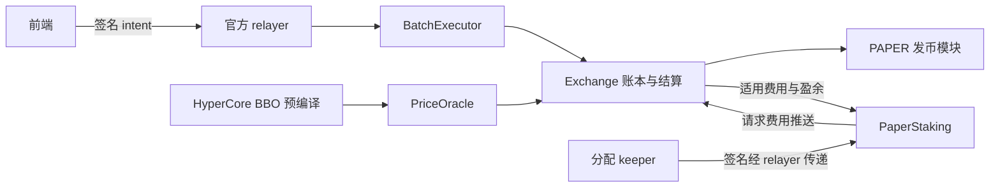
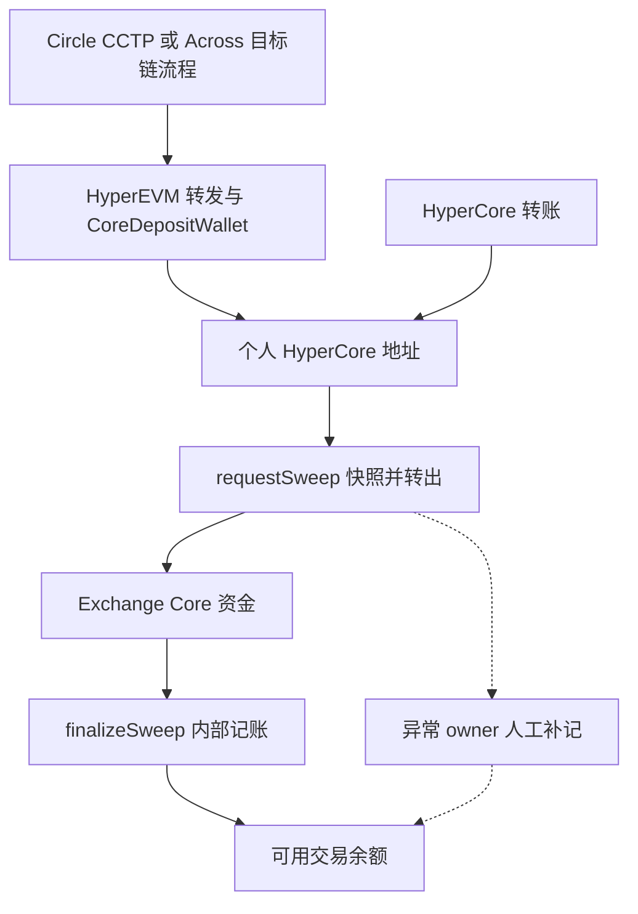

# Papertrade：产品、合约、服务架构与业务模式

核查日期：**2026-10-28**。[English](current-product-review.md) · [确认更新与证据](research-notes/016-2026-10-28-sync.md)。

本文按**官网描述的 Contract set 2**解释机制，不是实时市场参数快照。官方页面来自本任务规划阶段成功的网页读取；实现路径沿用仓库注明日期的客户端采集，供应商资料用于核对其能力。升级交易另有回执和区块证据。这几类证据不能互相替代。

## 产品形态与设计理念

Papertrade 提供高杠杆合成敞口，直接与协议 LP 结算。Hyperliquid 提供参考价格，Papertrade 不会为每个仓位在 Hyperliquid 开一个对应永续仓位。产品把简化交易表单、会话密钥、relayer 代付交易 gas、BBO 中间价、亏损补充流动性和 PAPER 分红组合起来。[官方介绍](https://docs.papertrade.xyz/)

用户路径是：充值交易余额 → 授权交易 → 开立独立仓位 → 平仓或清算 → 获得现金、债权及符合条件的 PAPER → 质押 → 领取已分配 USDC → 提现。盈利已结算、奖励可领取和外部钱包实际到账，是不同阶段。

此前检查的客户端支持选择若干仓位整仓关闭，多空各仓独立；其签名没有建立原生限价、TP/SL 或按数量部分平仓能力。这些观察仍适用于[当时采集的客户端](research-notes/012-independent-clients-orders-and-bridges.md#position-management-and-order-types)。宣传的 1000× 上限不等于当前每个市场、方向和账户都能开到该杠杆。

**设计分析：** 预编译读取价格，使协议省去独立撮合引擎；把成本放在成功交易的结果上，避免极高杠杆下按名义本金收取的费用立即吞噬保证金；亏损发币则鼓励用户间接提供风险资本。这同时把交易、发币稀释和未来亏损流量绑在一起，发行 PAPER 本身不会增加 USDC。

## 合约结算与真实交易成本

[官网盈利计算](https://docs.papertrade.xyz/how/asymmetric-impact/)的顺序是：

1. 扣掉最前面 0.2 bps 顺向价格变动，称为 deadband。
2. 在选中的小幅盈利区间内应用 holdback。
3. 对调整后的盈利应用 asymmetric impact。
4. 在费用适用分支，对缩减后的盈利扣 win fee。

标准曲线的 holdback 区间为 **0.75–6 bps**，非正常时段曲线为 **0.3–10 bps**，由专门 keeper 在两套合约曲线之间切换。impact 使用每市场参考名义本金，不按用户实际仓位大小提高扣减比例。因此，“按同一个中间价执行”和“小额毛利被大幅扣减”可以同时成立。零滑点并不保证拿到价格变动对应的全部杠杆毛利。

| 情况 | 官网描述 |
|---|---|
| 普通盈利平仓 | 价格调整及 impact 后，正常 2% win fee 留下缩减后盈利的 98%。 |
| 上述分支带获批 Builder | 再扣缩减后盈利的 0.5%，留下 97.5%；不是名义本金的 2.5%。 |
| 亏损交易者 | 不在已实现亏损外另加一笔费用；LP 侧费用仍会影响留存与发币基数。 |
| 亏损平仓的 Builder | 适用的 0.5% 从 LP 收益划出，并排除在 PAPER 基数之外。 |
| 清算，包括在 bust 或更差价格执行的平仓 | 不付 Builder 费，必须先识别硬清算分支。 |

Builder 记账要求付款队列为空且 LP 能支付。盈利时，即使不满足 Builder 记账条件，交易者仍承担该额外扣减，资金留在 LP。官方前端不登记 Builder。Builder 领取先进入交易余额，覆盖不了的部分可以进入兑付队列。批准与费率修改经过时间锁，费率上限 1%；多签可立即移除 Builder。[Builder 细则](https://docs.papertrade.xyz/how/builder-codes/)

普通盈利算例不能替代不同现金、债权及费用豁免分支的账务。[既有账务研究](research-notes/011-loss-governance-staking-and-payments.md#1-why-equal-losses-can-produce-different-paper-amounts)保留这些区别。清算触发缓冲与保证金归零边界也应分开，具体公式须保留[原核查的版本和舍入范围](research-notes/006-current-mechanisms.md#liquidation-exact-buffer-basis-and-inclusive-threshold)。

## LP、PAPER 与分红

官网描述的模式没有普通的直接注资 LP 入口。现金亏损补充资金池，不能即时支付的盈利形成排队债权。以债权作保证金的仓位，亏损只是减少负债，并没有新的外部现金流入。FIFO 决定先后次序，不承诺付款期限。[官方介绍](https://docs.papertrade.xyz/) · [现金与债权研究](research-notes/007-queue-and-dividend-payment.md)

现行描述按已有 PAPER 供应量发币。tracked LP 为负时，仅符合条件且用于填缺口的部分获得时间加成，连续三天最高升到 5 倍。教学例：已确定的合格基数 100、缺口 30、加成 5 倍，加权基数是 **30 × 5 + 70 = 220**，不是 500。这个例子从已经确定的基数开始，不代表费用扣除和整数舍入的完整合约账本。

质押收入包括：队列为空、LP 可覆盖时，适用盈利与亏损结算中的 1% 份额；以及 LP 超过官网所述 $5M 分红门槛后的可分配盈余。债权保证金清算另有例外。PAPER 初期只能走允许的质押转移路径，持币总量和已分配 USDC 权益不能混为一谈。[官方介绍](https://docs.papertrade.xyz/)

[质押文档](https://docs.papertrade.xyz/paper/staking/)明确 stake、unstake、claim 经签名和 relayer 传递；分配使用 keeper 签名。只有 PaperStaking 能请求推送 Exchange 的质押费用，分配再更新 `accRewardPerShare`。`pendingReward` 只包含已分配奖励；退出质押没有冷却期，已累计奖励仍可领取。份额按分配时点计算，不额外按持有时间加权。

## 服务架构与权限

| 组件 | 职责及依赖 |
|---|---|
| 前端、会话密钥 | 构造授权和交易请求；授权有效不等于某笔交易完成。 |
| Relayer、BatchExecutor | 指定 relayer 密钥提交批次；其他前端开平仓仍经过此服务，兼容签名不自动获得执行权限。 |
| Exchange | 余额、仓位、LP、结算和兑付队列。 |
| PriceOracle | BBO `0x080e` 用于执行价；mark `0x0806` 与 oracle `0x0807` 的分析、预留用途不同。 |
| PAPER 合约、keeper | 发币、质押和分配；服务是否及时运行与合约记录是不同问题。 |
| 充值工厂、代理、sweeper | 个人地址、代理部署、到账检测和分阶段入账。 |
| 治理 | 升级、参数、Builder 管理及异常充值补记。 |

上述为[官方架构](https://docs.papertrade.xyz/how/architecture/)、充值和质押文档的职责划分。链上结算仍依赖请求接收、批处理、索引和 keeper；架构图不推测未公开的数据库、云厂商或 SLA。会话注册经过 relayer，用户撤销授权则有直接钱包调用路径。

## 充值提现、桥和服务商

[官方出入金说明](https://docs.papertrade.xyz/learn/deposits-withdrawals/)列出 Hyperliquid、HyperEVM、Ethereum、Arbitrum、Solana 的 USDC，以及 Robinhood USDG。扣费后至少到账 10 USDC，首次充值另预留一次性 1 USDC 激活费用；提现至少 10 USDC，限于可用余额。这是产品规则，不是实时报价。

| 来源 | 文档及既有实现路径 |
|---|---|
| Ethereum、Arbitrum、Solana USDC | Circle CCTP／转发 → HyperEVM → CoreDepositWallet → 个人 HyperCore 地址 → 平台入账。 |
| Robinhood USDG | 既有客户端构造 Across 在 HyperEVM 的 fill／转发 → CoreDepositWallet → 个人 HyperCore 地址；当前充值文档也提到 Across fills。 |
| HyperEVM 原生 USDC | App 引导使用 CoreDepositWallet，进入个人地址的 HyperCore 一侧。 |
| HyperCore USDC | 内部转入已登记个人地址，再归集和确认入账。 |
| 提现 | Exchange 可用余额 → 用户 HyperCore spot；官方列出的继续转出目的地为 HyperEVM、Ethereum、Arbitrum、Solana。 |

前端构造细节见[笔记 012](research-notes/012-independent-clients-orders-and-bridges.md#funding-providers-and-actual-client-branches)，属于注明日期的旧客户端证据。其继续转出的授权是独立签名；不能根据资金转移先后，推断 App 何时要求签名。

Circle 的[HyperCore 文档](https://developers.circle.com/cctp/concepts/cctp-on-hypercore)佐证 CCTP 先到 HyperEVM，再经 CoreDepositWallet 到 HyperCore 的两步路线，并区分 HyperEVM 原生 USDC 与 HyperCore 协议级 credits。Across [链表](https://docs.across.to/chains-and-contracts)列出 HyperEVM 999 和 Robinhood 4663；支持链不等于所有代币对、金额和退款路线均可用。[当前 API 文档](https://docs.across.to/api-reference)要求 Bearer 和 `integratorId`，新接入须区分 Swap API 与旧采集中的 legacy 路线。

[充值内部机制](https://docs.papertrade.xyz/how/deposits/)补充了重要异常：如果另一笔充值掩盖代理余额下降，finalize 会丢弃原快照并重新归集；此前已经进入 Exchange 却未入账的资金，需要 owner 人工补记。App 因而串行处理充值。代理仅由 relayer 部署、仅 Exchange 可触发代理归集；请求和确认归集是公开维护入口。直接把 ERC-20 转到同地址的 HyperEVM 一侧，不会按普通充值入账，文档提供独立恢复路径。

因此，来源链回执、桥和转发完成、Core 到账、归集、平台余额入账，应分别确认。产品激活预留、HyperCore 账户激活和桥／转发费也需分开记账，不能用供应商收费说明替换 App 产品规则。

## 业务模式与参考研究

| 参与者 | 经济角色 |
|---|---|
| 交易者 | 承担亏损和盈利扣减，获得已付盈利、债权及符合条件的 PAPER。 |
| 协议 LP | 留存净亏损与扣减、支付盈利和负债、提供可分配盈余。 |
| PAPER 质押者 | 分享分配；持币不变时会被新增发行稀释，USDC 回报依赖资金和分配。 |
| 获批 Builder | 提供前端和流量，获得有条件的归因费用；准入需要批准。 |
| Relayer、keeper | 提供执行和账户处理服务，代付交易 gas 属于运营成本，不代表跨链路线免费。 |
| 桥与转发服务商 | 提供跨生态资金移动，其费用独立于交易盈亏。 |

整体模式是亏损补充资金池、按交易结果收费，再通过 PAPER 和 Builder 分配激励。成交量、交易者亏损、LP 留存、协议费用、质押分配和经营利润属于不同口径。公开费率不能推出团队利润表；自举解释初始资本来源，不证明未来所有负债都能及时支付。

外部参考已检查实际适用范围：[Guardian 审计](https://guardian.security/portfolio/papertrade/protocol-review-2026-10-09/)针对指定代码并列明修复条件；[Udit 解说](https://uditsamani.com/papertrade-hyperevm/)明确基于 10 月 6 日文档；[检查的 SDK 提交](https://github.com/nirholas/papertrade-sdk/tree/483a760ef596564e5ad799357a92e5726dada9ba)早于第二版。它们提供核查方向和历史实现，不能自动证明当前部署。[参考材料核查与来源身份](research-notes/016-2026-10-28-sync.md#references-and-evidence-scope)
