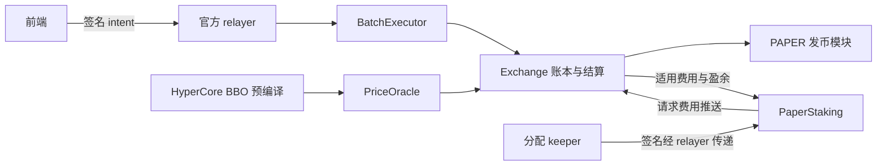
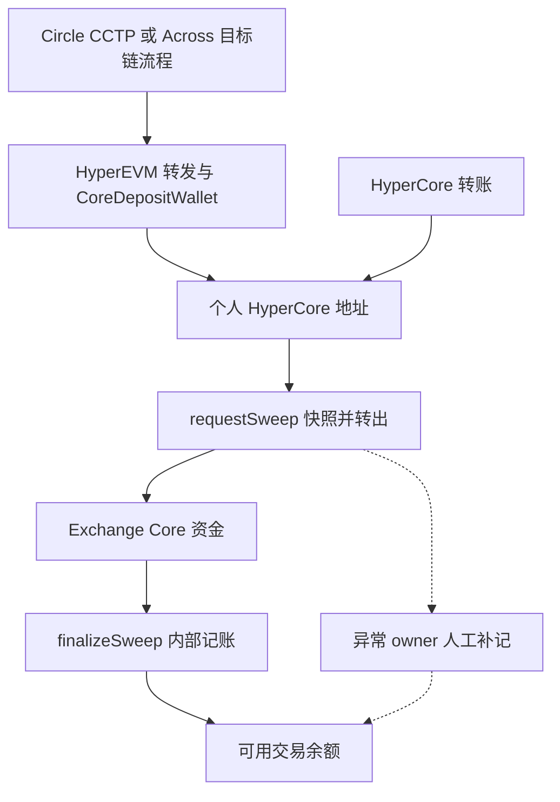
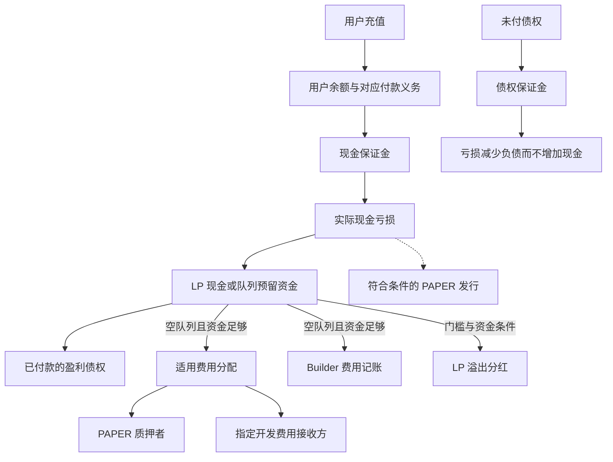

# Papertrade：产品、合约、服务架构与业务模式

[Mechanism/funding follow-up · 机制与资金补充](research-notes/018-mechanism-funding-and-authority.md).

核查日期：**2026-10-28**。[English](current-product-review.md) · [确认更新与证据](research-notes/016-2026-10-28-sync.md)。

本文按**官网描述的 Contract set 2**解释机制，不是实时市场参数快照。官方页面来自 10 月 28 日成功的网页读取，包括[体验与排队补充核查](research-notes/017-responsiveness-and-queue-stages.md)；实现路径沿用仓库注明日期的客户端采集，供应商资料用于核对其能力。升级交易另有回执和区块证据。这几类证据不能互相替代。

## 产品形态与设计理念

Papertrade 提供高杠杆合成敞口，直接与协议 LP 结算。Hyperliquid 提供参考价格，Papertrade 不会为每个仓位在 Hyperliquid 开一个对应永续仓位。产品把简化交易表单、会话密钥、relayer 代付交易 gas、BBO 中间价、亏损补充流动性和 PAPER 分红组合起来。[官方介绍](https://docs.papertrade.xyz/)

用户路径是：充值交易余额 → 授权交易 → 开立独立仓位 → 平仓或清算 → 获得现金、债权及符合条件的 PAPER → 质押 → 领取已分配 USDC → 提现。盈利已结算、奖励可领取和外部钱包实际到账，是不同阶段。

此前检查的客户端支持选择若干仓位整仓关闭，多空各仓独立；其签名没有建立原生限价、TP/SL 或按数量部分平仓能力。这些观察仍适用于[当时采集的客户端](research-notes/012-independent-clients-orders-and-bridges.md#position-management-and-order-types)。宣传的 1000× 上限不等于当前每个市场、方向和账户都能开到该杠杆。

**设计分析：** 预编译读取价格，使协议省去独立撮合引擎；把成本放在成功交易的结果上，避免极高杠杆下按名义本金收取的费用立即吞噬保证金；亏损发币则鼓励用户间接提供风险资本。这同时把交易、发币稀释和未来亏损流量绑在一起，发行 PAPER 本身不会增加 USDC。

## 定价风险与停市权限

[官网定价说明](https://docs.papertrade.xyz/how/pricing-bbo/)描述了零报价和交叉盘口（`ask < bid`）拒绝检查，但没有最大偏离、TWAP 时间加权价格或历史回看熔断。读取共识状态能确认读到哪组盘口，不能证明盘口没有受到经济操纵。Deadband、impact 和 OI 控制可以降低部分收益或限制敞口，仍不足以证明操纵无利可图。

| 控制方式 | 新开仓 | 已有仓位平仓和清算 | 能否恢复 |
|---|---|---|---|
| Guardian 退市一个市场 ID | 该 ID 禁止开仓 | 使用退市时冻结的买卖报价 | 同 ID 永久退市；重新上线需新 ID |
| Guardian 开启全局交易暂停 | 所有市场禁止开仓 | 继续使用实时 BBO | Owner 可以解除 |
| Market keeper 降低某侧 OI 上限 | 超过该侧上限的开仓失败 | 继续使用实时 BBO | 调整上限不等于退市 |

[风险页面](https://docs.papertrade.xyz/how/risk/)把 market keeper 权限限定在方向 OI 上限和开仓最低要求，off-hours keeper 只能选择两条固定盈利曲线。Owner 可管理参数、relayer／keeper、上币、异常充值补记及合约升级；Builder 批准和费率走治理，multisig 可即时移除 Builder。官网的启动 OI 策略是每侧已有持仓之外，保留按 BBO 计价的 **10 亿美元新增容量**，超出 10% 带宽后再调整。这是运营策略描述，不能当作今天实测的参数、全市场总 OI 上限或最大损失保证。

上述属于 set 2 文档规则；当前存储、运营响应速度及审计修复是否部署，需要各自验证。

## 合约结算与真实交易成本

[官网盈利计算](https://docs.papertrade.xyz/how/asymmetric-impact/)的顺序是：

1. 扣掉最前面 0.2 bps 顺向价格变动，称为 deadband。
2. 在选中的小幅盈利区间内应用 holdback。
3. 对调整后的盈利应用 asymmetric impact。
4. 从缩减后的盈利扣 win fee；资金条件决定费用接收方能否计提。

标准曲线的 holdback 区间为 **0.75–6 bps**，非正常时段曲线为 **0.3–10 bps**，由专门 keeper 在两套合约曲线之间切换。impact 使用每市场参考名义本金，不按用户实际仓位大小提高扣减比例。因此，“按同一个中间价执行”和“小额毛利被大幅扣减”可以同时成立。零滑点并不保证拿到价格变动对应的全部杠杆毛利。

| 情况 | 官网描述 |
|---|---|
| 普通盈利平仓 | 价格调整及 impact 后，正常 2% win fee 留下缩减后盈利的 98%。 |
| 上述分支带获批 Builder | 再扣缩减后盈利的 0.5%，留下 97.5%；不是名义本金的 2.5%。 |
| 亏损交易者 | 不在已实现亏损外另加一笔费用；LP 侧费用仍会影响留存与发币基数。 |
| 亏损平仓的 Builder | 适用的 0.5% 从 LP 收益划出，并排除在 PAPER 基数之外。 |
| 清算，包括在 bust 或更差价格执行的平仓 | 不付 Builder 费，必须先识别硬清算分支。 |

Builder 记账要求付款队列为空且 LP 能支付。盈利时，即使不满足 Builder 记账条件，交易者仍承担该额外扣减，资金留在 LP。官方前端不登记 Builder。Builder 领取先进入交易余额，覆盖不了的部分可以进入兑付队列。批准与费率修改经过时间锁，费率上限 1%；多签可立即移除 Builder。[Builder 细则](https://docs.papertrade.xyz/how/builder-codes/)

普通盈利算例不能替代不同现金、债权及费用豁免分支的账务。[既有账务研究](research-notes/011-loss-governance-staking-and-payments.md#1-why-equal-losses-can-produce-different-paper-amounts)保留这些区别。清算触发缓冲与保证金归零边界也应分开，具体公式须保留[原核查的版本和舍入范围](research-notes/006-current-mechanisms.md#liquidation-exact-buffer-basis-and-inclusive-threshold)。

### 现金、债权与不同结算分支

这里 `M` 是保证金，`L` 是已实现亏损，`G` 是经过 deadband、holdback 和 impact 后的正盈利。普通净盈利为 `0.98G`，带文档所述获批 Builder 时为 `0.975G`。下表解释[第二版规则](https://docs.papertrade.xyz/how/solvency-queue/)，不代表整数结算复现。

| 保证金／结果 | 余额或债权 | 现金与费用 |
|---|---|---|
| 现金／盈利 | 返还 `M`；净盈利能付的付、剩余排队；已有旧债时新盈利全部排队 | 用户扣减与费用能否分给接收人分别判断 |
| 债权／盈利 | `M＋净盈利` 是剩余付款义务，按条件付款或排队 | 重用债权没有带来新现金 |
| 微小顺向波动被 deadband 抹去 | 无正调整后盈利；现金保证金返还，债权保证金仍为债权 | 原始报价顺向变化不保证正净盈利 |
| 现金／亏损、队列为空 | 返还 `M-L`；LP 留下净亏损资金 | 适用费用从 LP 收益划出，不额外扣用户 |
| 现金／亏损、已有队列 | 返还 `M-L`；亏损资金经 `sideBucket` 支持旧债 | 亏损费用豁免，PAPER 资格另算 |
| 债权／亏损 | 销毁 `L`；剩余 `M-L` 付款或再排队 | 不增加现金；普通亏损费用要求空队列且现金覆盖剩余债权及费用，Builder 也有资金条件 |
| 现金／硬清算 | 全部保证金损失 | 现金补 LP 或支持旧债；队列状态影响清算费用；无 Builder |
| 债权／硬清算 | 全部保证金债权销毁 | 无现金或 sideBucket 流入，无清算及 Builder 费用 |

一个**顺向波动 4 bps 的教学例**：按官网公式，标准曲线 holdback 约 **1.05024 bps**，off-hours 约 **2.03250 bps**；再扣 0.2 bps deadband，有效波动约为 2.74976 或 1.76750 bps，之后才做 impact 和费用计算。这是十进制公式解释，不是当前参数或 Solidity 舍入复现。另假设缩减后盈利已是 100，扣费后为 98 或 97.5，返还保证金另算。这里不推导临界资金下多种费用的精确执行顺序。

## LP、PAPER 与分红

官网描述的模式没有普通的直接注资 LP 入口。现金亏损补充资金池，不能即时支付的盈利形成排队债权。以债权作保证金的仓位，亏损只是减少负债，并没有新的外部现金流入。FIFO 决定先后次序，不承诺付款期限。[官方介绍](https://docs.papertrade.xyz/) · [现金与债权研究](research-notes/007-queue-and-dividend-payment.md)

现行描述按已有 PAPER 供应量发币。tracked LP 为负时，仅符合条件且用于填缺口的部分获得时间加成，连续三天最高升到 5 倍。教学例：已确定的合格基数 100、缺口 30、加成 5 倍，加权基数是 **30 × 5 + 70 = 220**，不是 500。这个例子从已经确定的基数开始，不代表费用扣除和整数舍入的完整合约账本。

质押收入包括：队列为空、LP 可覆盖时，适用盈利与亏损结算中的 1% 份额；以及 LP 超过官网所述 $5M 分红门槛后的可分配盈余。债权保证金清算另有例外。PAPER 初期只能走允许的质押转移路径，持币总量和已分配 USDC 权益不能混为一谈。[官方介绍](https://docs.papertrade.xyz/)

[质押文档](https://docs.papertrade.xyz/paper/staking/)明确 stake、unstake、claim 经签名和 relayer 传递；分配使用 keeper 签名。只有 PaperStaking 能请求推送 Exchange 的质押费用，分配再更新 `accRewardPerShare`。`pendingReward` 只包含已分配奖励；退出质押没有冷却期，已累计奖励仍可领取。份额按分配时点计算，不额外按持有时间加权。

## 服务架构与权限

| 组件 | 职责及依赖 |
|---|---|
| 前端、会话密钥 | 构造授权和交易请求；授权有效不等于某笔交易完成。 |
| Relayer、BatchExecutor | 指定 relayer 密钥提交批次；其他前端开平仓仍经过此服务，兼容签名不自动获得执行权限。 |
| Exchange | 余额、仓位、LP、结算和兑付队列。 |
| PriceOracle | BBO `0x080e` 用于执行价；mark `0x0806` 与 oracle `0x0807` 的分析、预留用途不同。 |
| PAPER 合约、keeper | 发币、质押和分配；服务是否及时运行与合约记录是不同问题。 |
| 充值工厂、代理、sweeper | 个人地址、代理部署、到账检测和分阶段入账。 |
| 治理 | 升级、参数、Builder 管理及异常充值补记。 |

上述为[官方架构](https://docs.papertrade.xyz/how/architecture/)、充值和质押文档的职责划分。链上结算仍依赖请求接收、批处理、索引和 keeper；架构图不推测未公开的数据库、云厂商或 SLA。会话注册经过 relayer，用户撤销授权则有直接钱包调用路径。

## 为什么体感快

**行情刷新、操作反馈和最终结算，走的是不同的时钟。** K 线一直动，自己的订单仍可能在等。下面的客户端细节来自 **2026-10-22 构建 `2b8e2c45a33e`**，用于解释设计，不能当作今天部署的性能实测。

| 用户看到的体验 | 已采集实现或官网机制 | 后面还要完成什么 |
|---|---|---|
| 报价和 K 线持续更新 | 客户端直接订阅 Hyperliquid WebSocket 的 `bbo`、`candle`，历史价格与 K 线另走 HTTP 补取。 | 用户自己的交易仍要独立执行；图表使用的按挂单量加权价格和合约执行用的 BBO 中间价，也不能直接画等号。 |
| 余额、仓位和操作状态不用刷新网页就变化 | 账户 SSE 持续推送快照和增量；补丁的 `baseAccountRevision` 必须匹配，重连后重新取得完整快照。 | 账户索引要追上对应操作，收到请求回执还不够。 |
| 开平仓点击很顺手 | 已注册的 session key 代签，省去逐笔主钱包弹窗；relayer 为其发送的交易付 gas。 | 仍要受理、组批和执行成功；提现要主钱包签名。 |
| 充值需要手动操作的步骤少 | 可预先计算的个人地址收款，桥转发和 sweeper 串联到账、转移、内部入账。 | 外部桥、首次部署代理、归集确认和账户索引都可能增加等待。 |

这里的 WebSocket 是保持连接来接收更新，SSE 是服务器向浏览器单向发送事件；revision 可以理解成“状态版本号”，用来检查小更新能否接在已有快照上。网页因而可以接收少量变化，而不用每次重新拉整个账户。

[已采集的数据消费者](research-notes/013-market-state-funding-and-upgrade-followup.md#2-assemble-three-independent-data-planes)还会在一次连接周期内丢弃时间更旧的报价，断线重订阅后单独恢复历史；账户补丁则避免把更新接到错误的旧状态上。**设计解释：** 长连接推送、增量更新和预授权，减少了反复查询、整页刷新和钱包交互。这些机制可以解释体感，但没有给出延迟、帧率、吞吐或断线无丢失的实测保证。能否交易、杠杆限制等通过另一条 `trading:current` 通道更新，它不负责提供行情。

[现行充值指南](https://docs.papertrade.xyz/learn/deposits-withdrawals/)把 Hyperliquid 来源描述为数秒入账，其他链则取决于桥完成。[个人代理说明](https://docs.papertrade.xyz/how/deposits/)解释了先收款、后部署与归集，用户在引导流程中不用再对 Exchange 单独做批准和充值操作。自动化减少手动步骤，仍依赖服务运行和后文的分阶段入账检查；来源链钱包批准和桥费要按路线看。

## 到底在排什么队

| 等待类型 | 在等什么 | 怎样才结束 |
|---|---|---|
| 执行请求等待 | relayer 选择请求、组织批次、上链处理，以及账户同步。 | 对应操作执行成功，或进入其他明确终态。 |
| 盈利兑付等待 | 已结算的债权等待付款资金。 | 按 FIFO 规则偿付，已付部分变成可用余额；顺序不代表期限。 |
| 提现处理等待 | 可用余额提到 HyperCore，再按选择继续转出。 | 逐段确认，直到选定目的地实际到账。 |

### 请求受理：还要等自己的操作执行

[官方架构](https://docs.papertrade.xyz/how/architecture/)要求开平仓经获准的 relayer 和批处理合约。[历史批次核查](research-notes/007-queue-and-dividend-payment.md#execution-array-order-and-partial-failures-are-real-scheduler-fifo-is-unknown)确实发现一笔成功交易中同时有成功项和失败项，因此整批回执成功不能代替自己的成交结果。批内按提交数组执行有证据；跨用户是否 FIFO、谁优先、怎样重试，尚未建立。旧公开压力指标按已提交 gas 计算饱和度，不覆盖全部等待请求，因此饱和度低也不能说明执行队列已清空。[注明日期的压力观察](research-notes/008-core-credit-and-relayer-pressure.md#real-backend-observation-anonymous-relayer-pressure)。

已采集客户端每两秒刷新排位，普通 intent HTTP 超时为 35 秒，不明确的受理回执保留为 `unconfirmed`。这些是客户端行为。[会话文档](https://docs.papertrade.xyz/learn/session-keys/)规定每笔签名交易有效一小时；这些时长都不是保证成交时间，HTTP 超时也不证明请求已取消。合约处理交易时才读取执行价格，点击时看到的价格不会在排队期间锁住；已有仓位还可能在平仓请求执行前先被清算。

### 盈利兑付：返还现金与排队债权分别看

[现行队列指南](https://docs.papertrade.xyz/learn/lp-queue/)把现金保证金和未付盈利分开。[技术模型](https://docs.papertrade.xyz/how/solvency-queue/)描述 FIFO 债权及为其付款预留的 `sideBucket`，新赢家不能越过已有债权先拿钱。现金仓位在平仓执行后，剩余保证金回到可用余额；在 bust 或更差价格执行则按清算损失保证金。

**条件教学例，不是真实交易：** 现金保证金 100 USDC，扣完适用调整和费用后的净盈利为 30。假设起初兑付队列为空、不触发清算，LP 此时只能直接支付其中 10。平仓后是 **110 可用余额**（返还保证金 100＋已付盈利 10），另有 **20 排队债权**。如果前面已有兑付队列，就不满足这个例子中“先直接付 10”的前提。

**债权保证金例：** 用 100 排队余额作保证金，已实现亏损销毁其中 20，剩余债权为 **80**；它变为可用余额还是重新排队，仍取决于付款能力和先后顺序。这里没有又充值 100 USDC。可以继续交易与可以提现现金，是不同的能力。两例只拆解余额算术，没有重建完整费用账本、整数执行或真实活跃队列。[既有账务区别](research-notes/011-loss-governance-staking-and-payments.md#5-payment-capacity-when-many-traders-win)。

`sideBucket` 是 treasury 现金内部的预留，不能重复算作自由 LP 现金。`harvest(maxEntries)` 推进有资金支持的偿付，并先消耗这部分预留。官网描述 keeper 在有钱可付时调用 `harvest(32)`，**32 是处理条目参数，不是 32 秒到账**。反复调用也不会产生缺少的现金。用户充值同时新增用户余额负债，不能当作 LP 可以自由使用的新收入。既有历史材料没有提供真实活跃队列的部分偿付复现。

### 提现处理：沿资金路径确认到最后一站

**可用余额 → 主钱包授权与提现执行 → CoreWriter → HyperCore 到账 → 可选跨链 → 目的链到账。** 返还的现金保证金可按产品最低额与授权规则提现；未付盈利债权要先变成可用余额。因此，“盈利等兑付”不能解释所有提现等待。

已采集官方 App 通过服务提交提现 intent，并在客户端限制同一时间只挂一笔提现。这个本地限制不能当成通用合约队列：架构允许任何人递送正确授权的提现调用，签名和余额等检查仍然有效。[客户端等待规则](research-notes/007-queue-and-dividend-payment.md#frontend-waiting-rules-what-is-actually-in-the-current-client)。

| 已采集的继续转出状态或证据 | 应该怎样理解 |
|---|---|
| `submitted`／`in_transit` | 转出模型里的处理阶段，单凭它们不能确认目的地到账。 |
| `needs_signature` | 客户端要求更新继续转出授权；已采集的续签路径不会再创建一笔 Exchange 提现。 |
| 平台 `settled` | 已采集外部 Circle 路线还要等 Iris 给出 `forwardTxHash`，时间线才显示收到；核实最终到账仍须目的链回执。 |
| `failed` | 仅有错误状态，不能确定资金在哪，也不能认定已经退款。 |

这些是[10 月 22 日客户端语义](research-notes/013-market-state-funding-and-upgrade-followup.md#5-withdrawal-has-two-authorizations-and-another-completion-boundary)，不是今天界面文案或等待时间实测。[一个历史提现样本](research-notes/008-core-credit-and-relayer-pressure.md#selected-withdrawal-one-exact-official-ledger-match)有精确匹配的 HyperCore 入账，但不能说明所有提现的时效或后续桥已到账。判断一笔等待时，先确认操作类型和最后已证实的阶段；只看“queued”这个词还不够。

## 充值提现、桥和服务商

[官方出入金说明](https://docs.papertrade.xyz/learn/deposits-withdrawals/)列出 Hyperliquid、HyperEVM、Ethereum、Arbitrum、Solana 的 USDC，以及 Robinhood USDG。扣费后至少到账 10 USDC，首次充值另预留一次性 1 USDC 激活费用；提现至少 10 USDC，限于可用余额。这是产品规则，不是实时报价。

| 来源 | 文档及既有实现路径 |
|---|---|
| Ethereum、Arbitrum、Solana USDC | Circle CCTP／转发 → HyperEVM → CoreDepositWallet → 个人 HyperCore 地址 → 平台入账。 |
| Robinhood USDG | 既有客户端构造 Across 在 HyperEVM 的 fill／转发 → CoreDepositWallet → 个人 HyperCore 地址；当前充值文档也提到 Across fills。 |
| HyperEVM 原生 USDC | App 引导使用 CoreDepositWallet，进入个人地址的 HyperCore 一侧。 |
| HyperCore USDC | 内部转入已登记个人地址，再归集和确认入账。 |
| 提现 | Exchange 可用余额 → 用户 HyperCore spot；官方列出的继续转出目的地为 HyperEVM、Ethereum、Arbitrum、Solana。 |

前端构造细节见[笔记 012](research-notes/012-independent-clients-orders-and-bridges.md#funding-providers-and-actual-client-branches)，属于注明日期的旧客户端证据。其继续转出的授权是独立签名；不能根据资金转移先后，推断 App 何时要求签名。

Circle 的[HyperCore 文档](https://developers.circle.com/cctp/concepts/cctp-on-hypercore)佐证 CCTP 先到 HyperEVM，再经 CoreDepositWallet 到 HyperCore 的两步路线，并区分 HyperEVM 原生 USDC 与 HyperCore 协议级 credits。Across [链表](https://docs.across.to/chains-and-contracts)列出 HyperEVM 999 和 Robinhood 4663；支持链不等于所有代币对、金额和退款路线均可用。[当前 API 文档](https://docs.across.to/api-reference)要求 Bearer 和 `integratorId`，新接入须区分 Swap API 与旧采集中的 legacy 路线。

[充值内部机制](https://docs.papertrade.xyz/how/deposits/)补充了重要异常：如果另一笔充值掩盖代理余额下降，finalize 会丢弃原快照并重新归集；此前已经进入 Exchange 却未入账的资金，需要 owner 人工补记。App 因而串行处理充值。代理仅由 relayer 部署、仅 Exchange 可触发代理归集；请求和确认归集是公开维护入口。直接把 ERC-20 转到同地址的 HyperEVM 一侧，不会按普通充值入账，文档提供独立恢复路径。

因此，来源链回执、桥和转发完成、Core 到账、归集、平台余额入账，应分别确认。产品激活预留、HyperCore 账户激活和桥／转发费也需分开记账，不能用供应商收费说明替换 App 产品规则。

### 资金确认与收费口径

| 最后确认阶段 | 可以说明什么 | 仍需分别确认什么 |
|---|---|---|
| 源链回执或供应商 fill | 源链或供应商动作 | Core 到账与 Exchange 入账 |
| CoreWriter 指令 | 已发出转账指令 | HyperCore 执行结果 |
| 归集确认事件 | 记录报告的归集确认及金额 | 完整余额对账和来源归因 |
| 继续转出哈希 | 已识别或提交下一段转账 | 目的链成功回执与实际资产到账 |

10 月 22 日客户端比较累计 `depositedRaw`；累计值增加不能严格归因于某一笔并发或延迟跨链。继续转出续签更新的是 onward 授权，不是再次从 Exchange 提现。[旧版资金逻辑](research-notes/013-market-state-funding-and-upgrade-followup.md)

Papertrade 描述首存 1 USDC 激活预留，Circle 按首次 outbound 动作解释 HyperCore 激活扣费。二者范围和时点不同，不能叠加成已经观察到的两笔收费。App 的 10 USDC 到账／归集门槛也不是 Circle 全局最低存款要求。桥费和转发费随路线变化。[Circle 激活说明](https://developers.circle.com/cctp/concepts/cctp-on-hypercore)

本次核对的 Across legacy 警告针对 `available-routes`，不能扩展为所有旧端点都弃用，也不证明 Papertrade 已迁移、handler 已执行或退款已完成。[供应商说明](https://docs.across.to/api-reference/available-routes/get)

### 一笔归集阶段观察

[请求归集](https://hyperevmscan.io/tx/0x36a6bbbb73ed5b18a741ac1554dbf3662151461d68993ed33f4782c3bfaac2d2)与[确认归集](https://hyperevmscan.io/tx/0x1edb1e87295ea5c831fd7e20954532e2b6535de93aaa43124389e1d6c108efb7)记录均报告成功，区块 **49713666 → 49713667**，时间为 **10 月 28 日 UTC 02:43:35 → 02:43:36**。用户字段相符，CoreWriter 与 `Swept` 金额按既有 8／18 位单位换算对应 **38,287.75 USDC**。这支持两笔归集记录的一致性；一秒是区块时间戳差，没有计入来源资金、桥、Core 回执或网页更新。[核对值与范围](research-notes/018-mechanism-funding-and-authority.md#sweep-stage-observation)

## 业务模式与参考研究

| 参与者 | 经济角色 |
|---|---|
| 交易者 | 承担亏损和盈利扣减，获得已付盈利、债权及符合条件的 PAPER。 |
| 协议 LP | 留存净亏损与扣减、支付盈利和负债、提供可分配盈余。 |
| PAPER 质押者 | 分享分配；持币不变时会被新增发行稀释，USDC 回报依赖资金和分配。 |
| 指定开发费用接收方 | Owner 可设置该地址，官网把开发费用领取权限赋予该接收方；角色本身不证明最终受益主体。 |
| 获批 Builder | 提供前端和流量，获得有条件的归因费用；准入需要批准。 |
| Relayer、keeper | 提供执行和账户处理服务，代付交易 gas 属于运营成本，不代表跨链路线免费。 |
| 桥与转发服务商 | 提供跨生态资金移动，其费用独立于交易盈亏。 |

图中表示资金依赖关系，不代表每次整数记账的执行顺序。盈利扣减可能改善 LP 状况，却没有马上作为收入付给外部接收人；即使队列或资金条件不允许分配，盈利费用仍可能先被扣除。费用计提、奖励分配、领取到交易余额和提现，是不同环节。[队列与费用资金条件](https://docs.papertrade.xyz/how/solvency-queue/) · [接收方权限](https://docs.papertrade.xyz/how/risk/)

整体模式是亏损补充资金池、按交易结果收费，再通过 PAPER 和 Builder 分配激励。成交量、交易者亏损、LP 留存、协议费用、质押分配和经营利润属于不同口径。公开费率不能推出团队利润表；自举解释初始资本来源，不证明未来所有负债都能及时支付。

外部参考已检查实际适用范围：[Guardian 审计](https://guardian.security/portfolio/papertrade/protocol-review-2026-10-09/)针对指定代码并列明修复条件；[Udit 解说](https://uditsamani.com/papertrade-hyperevm/)明确基于 10 月 6 日文档；[检查的 SDK 提交](https://github.com/nirholas/papertrade-sdk/tree/483a760ef596564e5ad799357a92e5726dada9ba)早于第二版。它们提供核查方向和历史实现，不能自动证明当前部署。[参考材料核查与来源身份](research-notes/016-2026-10-28-sync.md#references-and-evidence-scope)
