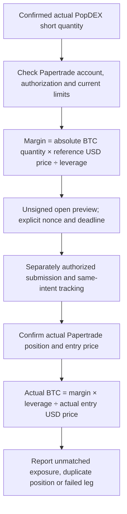

# Programmatic execution: current Papertrade research

Reviewed **2026-11-14**, frontend build **`2bfe899f52fe`**, HyperEVM **999**. [Evidence and source coordinates](../research/cases/013-programmatic-execution.json) · [Research log](research-notes/020-programmatic-execution.md) · [Code](../packages/research/papertrade/) · [Tests](../tests/papertrade.test.ts).

**Programmatic operation has a concrete signature → official relayer → account/chain reconciliation route. This study verifies public reads, current client construction and isolated-domain cryptography. It does not establish successful production registration, order admission or fills.** A custom frontend does not acquire the relayer's contract execution role.

Evidence labels below identify sources, not ascending confidence scores: **O** official documentation; **F** captured current official frontend; **C** public provider-reported chain data; **L** local tests; **U** unresolved inference or unperformed verification. Support, reproduction and implementation remain separate under the [research method](research-method.md). A local simulation never becomes production evidence.

## 1. What was checked and which version it describes

The four official entry pages and linked resources were fetched successfully with ordinary curl GETs. Python's default urllib User-Agent received Cloudflare `403 / 1010`; an honest descriptive research User-Agent received 200 with identical page hashes. No cookies, browser impersonation or challenge solving were needed. [Cloudflare describes this client-signature check](https://developers.cloudflare.com/support/troubleshooting/http-status-codes/cloudflare-1xxx-errors/error-1010/).

The collector discovered resource names from current HTML and module references. The metadata records capture start/end UTC, URLs, SHA-256, byte lengths and selected byte offsets. Third-party source bytes remain private; the repository publishes original explanations and reviewed metadata. All 60 HTTP/RPC capture records matched their private bytes and hashes when checked. Later parsed live-read artifacts are separately described; their local completion times are not latency measurements.

| Identity | Observation | Evidence and limit |
|---|---|---|
| Exchange proxy | `0x6cd5661646289fb6e65ea5c032310fded797d0a2` | O/F; signing uses the proxy |
| SessionKeyManager proxy | `0x8326eb8896e358717f10502ec73ce8d28e37b108` | O |
| BatchExecutor proxy | `0x233ff29b239abc1d7748605da9b205c3e008626e` | O |
| PaperStaking proxy | `0xaad6c7b0cc3014fc80ffedae0ed7ce5967b0f016` | O/F |
| Reference block | **51219500**, hash `0x0ee8ca24913ad23af3151f484b83f545afdceb2570766f1501b2023d49dfc0d9` | C; same header hash read again |
| Exchange implementation | `0x4e2adafc40c734e9a8f96458b83ad62ad2b8a964` | C; current alias appears in F deployment config |
| Session implementation | `0x0a2db5c7614b714fd9ec12b29bff3b4f4c545d82` | C; differs from October study |
| Batch implementation | `0xd334f2fd8040e81dece418a10a17763764e0d1cc` | C; differs from October study |

The metadata supplies implementation runtime Keccak hashes and RPC request coordinates. Explicit block tags and a repeated header are single-provider observations, not independent historical-state or consensus-finality authentication. The three new runtimes were identified, not completely semantically replayed. Old caller-gate and liquidation tests must retain their October scope.

The frontend's collateral address `0x6b9e773128f453f5c2c60935ee2de2cbc5390a24` is a funding wrapper, not the native token address. A bounded read-only `token()` call returned documented native USDC `0xb88339cb7199b77e23db6e890353e22632ba630f`. F declares EVM decimals **6**; Exchange trading accounting uses **18**. This is not a deposit test.

## 2. Operations and authority

| Operation | Official-client authorizer and route | Conditions / verification |
|---|---|---|
| Register Session Key | Master wallet signs `RegisterSessionKey`; `POST /intents` | O/F. Account must synchronize; client checks funding/authorization state and action pause. Server PAPER admission scope remains U. No registration sent. |
| Open / close | Registered Session Key signs Exchange data; official relayer → authorized BatchExecutor | O/F. Current authorization, deadline, nonce, funds, market/OI and intake checks. Arbitrary callers cannot infer execution permission from possessing a signature. Current master-wallet bypass is not established. |
| Cancel queued intent | Current Session Key signs `CancelIntent`; `POST /intents/{intentId}/cancel` | F. Client checks eligible local operation and valid key. Not a guaranteed rollback of an already executed item. Server race/rejection behavior U. |
| Renew authorization | Restore a usable local key, otherwise restore/unlock/create and register | O/F. A new authorization must be observed in account state. Re-registration/revocation races U. |
| Revoke key | Master wallet transaction to `SessionKeyManager.revokeSessionKey(key)` | O. Needs HYPE gas. Docs say still-queued trades signed by it are cancelled. Actual cancellation timing and newly deployed validator behavior U. |
| Stake / unstake / claim | Master wallet signs `Stake` / `Unstake` / `Claim`, relayed as `paperStake` / `paperUnstake` / `paperClaim` | O/F. Direct `stake` disabled per docs; PAPER auto-approves the staking path. No operations performed. |
| Withdraw to HyperCore | Master wallet `WithdrawToCore` signature, or documented direct wallet path | O/F. Session key cannot withdraw. Onward transfer uses separate Hyperliquid authorization. |
| Deposit | Route-dependent source-wallet funding, personal deposit route, sweep/finalize | O/F. Not a Session Key spend capability. Deposit-address check/deployment and bridge actions are writes, not account reads. |
| Distribute staking fees | Keeper-signed `distributeBySig` via relayer | O. Ordinary user/session authority does not provide keeper permission. |

These are authority descriptions, not a guarantee that a given relayer accepts a particular account, Origin, cookie context, build or builder. The [architecture](https://docs.papertrade.xyz/how/architecture/), [Session Key docs](https://docs.papertrade.xyz/learn/session-keys/) and [staking docs](https://docs.papertrade.xyz/paper/staking/) were reread for this study. Current contract permissions and off-chain admission must remain distinct.

### Funding and PAPER interface boundaries

F sends `paperStake`, `paperUnstake`, `paperClaim` and `withdrawToCore` through `POST /intents` with their signed structures listed below. Stake/unstake `amount` is 18-decimal PAPER; withdrawal is internal 18-decimal USDC. Claimed rewards credit Exchange balance, which is distinct from withdrawal delivery. The documented staking domain verifies at PaperStaking, not Exchange.

The current deposit-address helper calls `POST /funding/deposits/check` with `{user}`, same-origin credentials and the build header, and expects `{proxy}`. It can initiate/check deposit infrastructure and was **not called**. No Session Key registration type proves deposit authorization. Source-chain transfer, Circle/Across forwarding, CoreDepositWallet and sweep/finalize are separate funding stages; [the existing funding guide](independent-client-guide.md) retains their dated routes and limits. No bridge quote or transfer was obtained.

Withdrawals can include an unsigned outer `withdrawal` route descriptor and separately signed `onward` data. F renews stalled onward authorization through `POST /intents/{id}/onward`; the Hyperliquid signing domain has a zero verifying contract and its own millisecond nonce. This is not the Exchange nonce/deadline protocol. The funding query exposes `signed`, `submitted`, `in_transit`, `settled`, `needs_signature`, `failed`, which must not be reused as trade-fill states. Full bridge/onward fields and final receipts were not independently reproduced; this module intentionally does not construct production funding submissions.

### Session generation, storage, recovery and expiry

F's current external-wallet custody code generates an ephemeral secp256k1 key using the imported secure key generator, persists `{privateKey, expiresAtMs}` in browser localStorage under a chain/Exchange/master-scoped `papertrade.tradingKey.v1:` namespace, and uses browser locks for create/restore coordination. This is code inspection only: no user's storage or key was read. The current module also has a legacy signer iframe at the signing origin for restore/migration; its message bridge checks origin and source, and can request a separate wallet-signature encryption message. That wrap message is not trading registration. Embedded-wallet connectors may supply their own custody implementation, which was not exhaustively recovered.

The current client TTL is **2,592,000,000 ms = 30 days**, its trade deadline is `floor(nowMs/1000)+3600`, and its local readiness margin is **3,660,000 ms = 61 minutes**. Official docs summarize renewal at less than an hour remaining. The client compares the locally stored expiry with the indexed session expiry and uses the earlier value; local possession alone does not establish authorization. Restoration also requires a current account connection.

Registration includes `user`, `key`, `expiry`, `feeAddress`, `nonce`, `deadline`. The master signs; canonical registration sets `feeAddress` to zero. The register wrapper uses credentials `include`, a five-second timeout and no build header in that wrapper. Recognized response fields include `intentId`, `action`, `state`, and sometimes `queueRevision`; recognized states include queued/confirmed/failed/reverted/expired/cancelled. Those are client expectations, not a sampled successful response. The registration state machine watches pending operations and ultimately requires the key in `sessionKeys` with sufficient remaining life. For independent chain confirmation, obtain the registration item's actual receipt/event and registry state at a pinned block; this step remains unperformed.

Revocation must prevent later authorized use according to O; expiry likewise ends the authorization window. Neither event reverses an already executed trade. A pre-signed instruction can have executed before a later revocation, expiry or delayed snapshot. Exact queue purging, relayer timing, nonce rollback and same-key renewal behavior need the explicit live checklist below. Do not infer those semantics from the earlier implementation.

```mermaid
sequenceDiagram
    participant C as Client
    participant M as Master wallet
    participant R as Official relayer
    participant S as Session registry
    participant A as Account SSE / chain reads
    C->>C: Restore/create local key; synchronize account
    C->>M: RegisterSessionKey typed data
    M-->>C: Signature
    C->>R: registerSessionKey intent
    R-->>C: Correlated acknowledgement
    R->>S: Authorized registration execution
    S-->>A: Registry event and indexed session expiry
    A-->>C: Confirm key is authorized before trading
    Note over C,S: Receipt and key possession alone are insufficient
```

## 3. Signed requests, units and limits

The current type module has the same captured SHA-256 as the October type module. Equality establishes those bytes only; the frontend build, runtime implementations, configuration and backend can change independently. Third-party SDKs were not used as authoritative expected values. The October 21 issuance change does not imply a change to every signature type.

| Domain | Name / version | Chain / verifying contract |
|---|---|---|
| Exchange actions | literal `String` / `1` | 999 / Exchange proxy |
| PAPER actions | `PaperStaking` / `1` | 999 / PaperStaking proxy |
| Cancellation | `PaperTrade Intent Cancel` / `2` | 999 / Exchange proxy |

Current F supports the domains above; current on-chain domain acceptance has not been exercised. The acquired Exchange runtime does not expose the inspected EIP-5267 selector, so no such getter result is claimed.

```text
RegisterSessionKey(address user,address key,uint64 expiry,address feeAddress,uint256 nonce,uint64 deadline)
OpenPosition(address user,uint32 instrumentId,bool isLong,uint128 size,uint32 leverage,bool useDebt,uint256 nonce,uint64 deadline)
Close(address user,uint256[] positionIds,uint256 nonce,uint64 deadline)
CancelIntent(address user,bytes32 intentId,uint256 deadline)
WithdrawToCore(address user,uint256 amount,uint256 nonce,uint64 deadline)
Stake(address user,uint256 amount,uint256 nonce,uint64 deadline)
Unstake(address user,uint256 amount,uint256 nonce,uint64 deadline)
Claim(address user,uint256 nonce,uint64 deadline)
Distribute(address user,uint256 nonce,uint64 deadline)
```

| Field / amount | Meaning and units |
|---|---|
| `instrumentId` | Current deployment IDs: 0 BTC, 1 ETH. Join live configuration to deployment identity, not symbol alone. |
| `isLong` | Boolean direction, not a signed size. |
| `size` | **Collateral margin**, uint128, 18 decimal units. It is neither notional nor BTC quantity. |
| `leverage` | Positive whole-number multiplier, uint32; not a WAD multiplier. |
| `useDebt` | Use queued claim collateral rather than cash balance; not borrowing BTC. It requires separate executable-debt availability checks. Research hedge examples default false. |
| `nonce` | uint256 application nonce. Not an EOA transaction count. |
| `deadline`, `expiry` | Unix seconds; deadlines are uint64 except cancellation's uint256. Browser TTLs and stream timestamps may instead use milliseconds. |
| Entry/bust prices | uint64 integers with per-instrument scale: current BTC 10, ETH 100. These are not 18-decimal USD values. |
| Margin/notional/balance/PAPER raw fields | Generally 18-decimal protocol/token units; field-specific validation still applies. Native USDC transfers are 6-decimal: multiply by `10^12` to enter internal accounting. |

HTTP submission is `{action, signed}`. The `signed` object contains the message fields plus `v`, `r`, `s`; uints and uint arrays serialize as decimal strings, booleans remain booleans, addresses/bytes are lowercase, and `v` is a decimal string 27 or 28. `Close` is the signature type while `closePositions` is the HTTP action. Cancellation uses a **flat** signed object at the target-specific URL, without the outer action envelope.

The deterministic correlation value is:

```text
digest   = keccak256(0x1901 || domainSeparator || hashStruct(message))
intentId = keccak256(keccak256(UTF8("papertrade:intent-id:v2")) || digest || recoveredSigner)
```

The signer occupies **20 raw bytes**, not an ABI-padded word. Ordered uint256 arrays hash their concatenated 32-byte elements. L uses a published EIP-712 reference digest, fresh ephemeral keys in a chain-31337 `Papertrade Research Test` domain, real signature recovery, and an independent byte-concatenation check. It does not produce production-domain authorizations. [EIP-712](https://eips.ethereum.org/EIPS/eip-712), [viem hashing](https://viem.sh/docs/utilities/hashTypedData) and [recovery](https://viem.sh/docs/utilities/recoverTypedDataAddress) supply the primitive references.

The client partitions nonce storage by chain, verifying contract, master and `session`/`paper` group. Registration, opens, closes and withdrawal share the inspected session route; PAPER actions use the staking route. It seeds from three random bytes multiplied by 256, then increments under browser locks. This does not coordinate a server process with other browsers/devices, prove contract bitmap semantics or authenticate nonce reuse. The library therefore requires explicit nonces; it does not invent a global nonce service.

### Current configuration and price protection

Anonymous `trading:current` observations disclosed:

| Parameter | Observed value | Scope |
|---|---|---|
| Minimum margin | **10 USDC** (`10e18`) | API configuration; mutable |
| Minimum open notional | **500 USDC** (`500e18`) | API configuration; mutable |
| Maximum leverage | **1000×** | Global and current market configuration |
| Minimum-leverage control | **0** | Raw control value; not permission to open at 0×. Client rejects nonpositive leverage. Exact zero-sentinel policy U. |
| Maximum position notional | **10M USDC** | Current market tuples, margin × leverage |
| `minimumPaperStakeRaw` | **1,000 PAPER** (`1000e18`) | Relayer intake configuration; not proven to be a contract-level gate |
| `accountOiCapRaw` | `10000000000000000000000000` | Captured raw account control; F compares it with per-instrument notional; server enforcement needs evidence |

Market tuples also contain directional OI and cap fields, and account snapshots can carry account-specific OI caps. F displays directional `longOiRaw`/`shortOiRaw` in USD by multiplying by the scaled price and dividing by `priceScaleRaw`, supporting 18-decimal underlying-quantity units for those two fields. The account-cap consumer instead sums `marginRaw × leverage` per instrument, including pending opens with intent-ID deduplication, so that cap is a notional control. Market-cap conversion and server aggregation still require revalidation; do not equate every raw OI field with USD or BTC. Global, market-side and account limits can bind separately. `validateOpenLimits` checks explicit already-interpreted local limits and available funds; it does not reproduce the relayer's OI admission or concurrent reservations.

The 1,000 PAPER field and `below_minimum_paper_stake` error are established by F/API. Which actions are gated, whether existing sessions are grandfathered, and whether the threshold tests aggregate stake or a particular stake event remain **U**. No rejection POST was sent to answer those questions. There is no basis here to call it a one-time staking payment or to apply it to closes/revocation.

O describes execution at HyperCore BBO midpoint, read by the contract when execution occurs, and frozen BBO for retired market IDs. F's open/close messages contain **no limit price, trigger price, slippage bound or requested execution price**. No native limit/TP/SL or partial-close capability is established. A displayed reference price cannot constrain a later execution. O documents hard liquidation for a close executed at/beyond the buffered bust trigger; that branch was not replayed against the new runtime.

The zero builder in canonical registration avoids naming an approved builder. O says approved builders ordinarily receive 0.5% of relevant PnL: deducted from scaled winning profit or carved from LP gain on a loss, with no builder fee on liquidation. Approval, funding and payout-queue conditions affect accrual. Builder selection belongs to session registration, not an arbitrary unsigned extra field on an open. Actual builder settlement remains unperformed.

## 4. Reads, subscriptions and final execution

| Interface | Request / observed result | Auth, precision and limits |
|---|---|---|
| Protocol summary | `GET /query/protocol/summary`, 200 | Anonymous; protocol aggregate and source block/time, amounts encoded as decimal strings. This is not personal available margin. |
| Fine price history | `GET /query/markets/{id}/price-history`, `fromMs`, `toMs`, `intervalMs` | Anonymous 200 for a six-hour window at 60,000-ms resolution (360 points, provider coverage complete). A 1,000-ms probe returned 400; supported interval/window combinations are not exhaustively established. Coverage/gaps/revision belong to the history series, not account execution. |
| Quotes/candles | Hyperliquid WS `bbo` / `candle`; historical `POST /info` read type `candleSnapshot` | F source route; not exercised here. Scaling is instrument-specific. |
| Trading rules | Public `wss://stream.papertrade.xyz/connection/websocket`, `trading:current` | Anonymous bootstrap and later full publications received. JSON Centrifugo framing; initial publication can be inside subscribe reply. |
| Account state | `GET /state/user/live?wallet=…`, SSE `wallet` events | 200 without credentials for a synthetic unregistered burn address. Real nonempty-account access is not established by that test. F uses EventSource with credentials. |
| Queue ranks | `GET /queue-rank/accounts/{wallet}`, 200 | Synthetic address returned empty entries. `queueRevision` may be absent. Rank is not finality. |
| Histories | `GET /query/accounts/{wallet}/{trades,cashflows,staking,queue}` | Trades live-tested with synthetic empty history; other routes F only. `items`, `nextCursor`; client requests 75, validates up to 200 returned items. Server accepted range remains U. |
| Funding progress | `GET /query/accounts/{wallet}/funding` | F only. Funding statuses have separate semantics; not order execution states. |

**Canonical query ordering matters.** Current history `?limit=75&filter=all` returned 400 with a canonical URL; `?filter=all&limit=75` returned 200. Plain history and `?filter=all` also returned empty history; a `limit=50` probe returned 400. Do not infer an arbitrary server pagination range from the frontend response schema. Current code sorts query keys and follows explicit opaque cursors; repeated cursors and incomplete history must not be treated as complete account history.

Current GET wrapper uses same-origin credentials, `Accept`, redirect rejection and a ten-second timeout. The trade wrapper adds `X-Papertrade-Build`, uses 35 seconds and does not retry mutations. The generic query client honors `Retry-After` and separates query/edge cooldowns. No numeric quota or SLA is published by the inspected sources; no rate-limit load test was performed. The research reader exposes 429/Retry-After and leaves retry decisions to its caller.

### Snapshot and increment protocol

SSE bootstrap emits `liveness` with `heartbeatIntervalMs`, then a full `wallet` object. Heartbeats carry JSON null. F uses connection/bootstrap timeouts of 15 seconds, silence up to 45 seconds bounded by three advertised heartbeat intervals, and resynchronizes if a queue-revision barrier stays behind. These are client controls, not measured server guarantees.

The full wallet includes `address`, positive `accountRevision`, `walletRevision`, `queueRevision`, indexed block/time, session keys, balance/queued/locked, available/reserved funds, consumable debt, PAPER state, operations, OI caps and position tuples. A position tuple is:

```text
[positionId, instrumentId, isLong, useDebt, entryPriceRaw, marginRaw,
 leverage, bustPriceRaw, openedAtMs, openingIntentIdOrNull]
```

An update has `baseAccountRevision`, new `accountRevision`, partial `state`, added/removed positions and operations, optional closed-position tuples and `intentOutcomes`. Outcomes are `succeeded`, `failed`, `expired`, `cancelled`, `unknown`. Base revision must match; revisions can jump, so assuming every valid update increments exactly one is incorrect. Position `intentId` is nullable; a null does not justify guessing a match by time or size.

On disconnect or a missing/out-of-order/invalid increment, stop treating the mirror as current, reconnect, and require a **full snapshot**. Do not apply an increment as a snapshot. Check source index age separately from receive time. `AccountMirror` implements that conservative subset, validates core fund/position joins, and exposes raw operations/PAPER fields; it is not a full substitute for every frontend schema or cross-device reservation mechanism. The live check covered an empty bootstrap; nonempty increments/reconnects are offline simulations only.

The official public WS requests Fossil delta support. The research client deliberately requests full publications and rejects unexpected deltas. It handles initial replay publications, later updates and ping/pong, and invalidates readiness on disconnect. It requires explicit resubscription and a new config snapshot after a gap; it does not promise SDK-grade automatic reconnection. [Centrifugo protocol reference](https://centrifugal.dev/docs/transports/client_protocol).

### What counts as a fill

```mermaid
sequenceDiagram
    participant C as Client and operation journal
    participant R as Official relayer
    participant B as BatchExecutor / Exchange
    participant A as Account stream / history / RPC
    C->>C: Reserve logical operation, nonce, digest and expected intentId
    C->>R: Signed open or Close request
    R-->>C: Accepted / queued acknowledgement, queueRevision
    Note over C,R: HTTP success does not establish execution
    R->>B: Authorized batch; per-item dispatch
    B-->>A: Item outcome, positions and settlement records
    A-->>C: Current matching position or close outcome
    C->>C: Reconcile IDs, direction, margin, leverage, entry price and exposure
    Note over C,A: Missing evidence stays unknown; query before retry
```

For an open, match the exact opening intent ID to **one** actual position, then verify instrument, side, margin, leverage and collateral mode. Read `positionId`, `entryPriceRaw` and actual exposure from it. If the position opened and closed between snapshots, or the ID is null, obtain history plus the relevant individual receipt/event instead of guessing. Duplicate or conflicting matches require intervention.

For a close, obtain individual success and verify all target position IDs are absent at a sufficiently current account revision; reconcile closed-position/history records to distinguish ordinary settlement from liquidation. Absence alone can also mean another close or liquidation. A later group's failure does not roll back earlier submitted groups. There is no partial-position size in `Close`; closing one of several separate positions is not partial closing of a single position.

A successful public batch receipt, [`0x4606…332a`](https://hyperevmscan.io/tx/0x4606ea2964f13785af7dc0c792d25fb47efd1b902e8a1cf12554abf3219a332a), was acquired in a bounded ten-block log window. Its top-level status was 1 with three logs. The metadata retains its block/hash, not wallet links or calldata. Individual outcome events were **not ABI-authenticated/decoded** in this increment. This supplies a real batch envelope, not evidence that the hypothetical hedge or any locally signed request executed. Production confirmation should additionally check receipt identity, item outcome, deployment version, sufficient finality and reorg handling. No universal finality depth is asserted here.

## 5. State machine, recovery and hedge integration

The research state machine separates `prepared`, `submitting`, `unknown`, `queued`, `executed`, `failed`, `expired`, `cancelled` and `reconcile`. These are local states; raw server state remains attached to the acknowledgement. A server `confirmed` receipt still maps to local queued/pending until execution evidence arrives. A recognized intake rejection is distinct from an ambiguous transport outcome; that rejection code vocabulary is F evidence, not a live-tested refusal path.

Recovery procedure:

1. Persist the logical operation key, expected intent ID, digest/nonce/deadline, requested positions and expected exposure before submission. Keep signatures and custody outside public logs/history. `ExecutionTracker.export()` is an in-memory serializable boundary, not a durable database; BigInts need the caller's explicit private storage encoding.
2. A timeout, lost response, malformed response, mismatched ID or ambiguous 5xx leaves the **same intent unknown**. Do not create another nonce/open. A retryable HTTP classification does not prove the first order failed.
3. Reconnect to current account state; wait for the relevant queue revision, inspect pending operations, exact position correlation and known terminal outcomes. Use history and individual chain evidence when snapshots cannot decide. An expired deadline alone does not prove the order did not execute earlier.
4. Retry/re-sign only after authoritative reconciliation proves no execution and an appropriate new authorization is explicitly chosen. The supplied submitter performs **zero automatic POST retries**; the tracker rejects a replacement intent under the same logical operation key.
5. A cancel request may lose the race to execution. A correlated actual fill takes precedence over cancellation being requested; conflicting terminal evidence enters reconciliation. Already closed IDs are re-read before another close. Record each close group independently, including earlier successes if a later group fails.

`IntentSubmitter` defaults `allowLiveWrites=false`, fails before signing/recovery/network when disabled, and accepts caller-provided signatures only. Its supported production routes are open/close/cancel. It checks expected domain, unchanged preview digest, recovered signer, deadline and caller-supplied session expiry/revocation status. Those supplied authorization inputs must themselves come from current verified state; the helper cannot authenticate them or guarantee admission. Registration/funding/PAPER operations have preview encoders and documentation, not a production funding CLI.

Simulation requires an injected transport and the isolated chain-31337 `Papertrade Research Test` domain; the default global fetch is rejected for this mode. Tests use only synthetic transports, never credentials or production signatures. No command-line route enables submission. There is no session-key storage implementation in the research library.

### PopDEX short + Papertrade long, without a strategy executor

The integration input is an independently confirmed **actual PopDEX BTC fill**, including a stable fill/operation identifier and direction. A PopDEX submitted quantity is not a fill. This study does not implement or test the PopDEX API.



For example, 0.01 BTC at reference 70,000 and 100× implies 7 USDC margin. That is below the current **10 USDC margin minimum**, even though notional 700 exceeds 500. The preview must report infeasibility rather than silently increasing size. At 10 margin and 100×, notional is 1,000, with BTC quantity determined only after entry. The helper rounds target margin upward by one internal unit where necessary and reports actual exposure using integer arithmetic.

Even an exactly calculated target margin cannot fix the entry price: if it changes before execution, BTC exposure changes. Compare the confirmed Papertrade BTC amount with the actual PopDEX fill, and define an acceptable residual externally before enabling any future strategy. The code returns quantities and detects mismatches; it chooses no tolerance, leverage, corrective trade or profit objective. The venues cannot atomically fill together. A successful single leg, stale account, rejected/unknown second leg, duplicate position or liquidation must remain observable. Automation does not remove queue delays, price differences, asymmetric payout deductions or the need to reconcile.

### Running the research code

```sh
pnpm install --frozen-lockfile --ignore-scripts
pnpm test
pnpm typecheck
pnpm validate:records
# Offline, unsigned arithmetic only:
pnpm papertrade preview-hedge 0.01 70000 100
# Explicit public reads; these are not part of the offline tests:
pnpm papertrade read-summary
pnpm papertrade read-config
# read-history <address> and read-account <address> are also read-only.
```

Use `previewOpen`, `preview('Close', …)`, `previewCloseGroups`, `preview('CancelIntent', …)` and `previewRevocation` for dry runs. PAPER and withdrawal typed data use `preview` with their exact kind. No preview calls a signer or sends a request. Default domains describe production; any local signature tests must explicitly supply the isolated test domain, as the repository tests do.

## 6. Remaining questions and minimal explicitly authorized live checklist

The following requires a future real-account authorization; it was **not** performed here. Complete read-only research and publication do not depend on it.

- Use a dedicated funded account with known stake and current deployment/configuration. Confirm the exact PAPER action gate, aggregate-vs-event policy, minimum leverage zero semantics, account/market OI units and limits with official backend evidence or one deliberately scoped authorized operation; do not send deliberately invalid POSTs under this research authorization.
- Register one key with zero builder using a reviewed master signature. Record exact response, intent ID, individual registry event/receipt, expiry and pinned registry read. Test restoration without inspecting/exporting a user's existing secrets. Establish any maximum-active-session rule and renewal behavior.
- Open one minimum-size permissible cash position; record user-observed send/ack times separately from block timestamps, follow pending state to position ID/actual price, and authenticate the individual execution event. No unmeasured millisecond claim follows from this checklist.
- Close it in full; reconcile account revision, history, fee/builder fields and ordinary-vs-liquidation settlement. Test batch grouping only with separately authorized positions; retain each group's outcome. Do not assume atomic close of an entire batch or partial-position support.
- In an explicitly approved controlled case, verify timeout reconciliation and cancellation/fill competition, then expiry/revocation of outstanding signatures. Confirm duplicate exact-intent behavior, nonce consumption/rollback and same-key re-registration; never repeat a new-nonce open merely to discover a server response.
- Establish real nonempty-account authentication/access, pagination completeness, rate/build/Origin policy, stream loss/recovery and chain finality/reorg policy. Funding and PAPER checks require separate master-signed operations; confirm source delivery, Exchange credit and final destination delivery independently.

Current completion is **research plus reusable code, tested boundaries and published limitations**. It is not certification of production trading or a completed arbitrage strategy.
